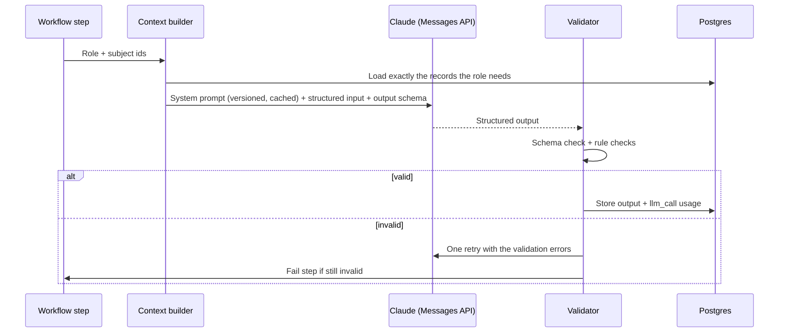

# AI agent architecture

Status: planning draft, 26 November 2026.

## 1. Approach

The studio uses Claude as a set of narrow, well-specified roles called from workflow steps. Each role has one job, a fixed input, a structured output, and a test set. The workflow engine owns the loop: order, retries, budgets and approvals are code, not model decisions.

This is a deliberate choice over one large autonomous agent. A single agent that "makes an episode" is hard to test, hard to price, hard to resume after a failure, and can spend money in ways nobody approved. Narrow roles inside a durable workflow give the same outcome with control at every step.

Where a role does need several tool calls of its own choosing (the planner looking up references, the revision agent exploring the timeline), it runs as a short tool-use loop inside one workflow step, with a hard cap on turns and tokens.

## 2. Roles

| Role | Job | Input | Output | Model (default) |
|---|---|---|---|---|
| Ingest analyst | Turn uploaded documents into structured Bible fields and list ambiguities | Document text, images | Draft records + questions | Opus 5.5 |
| Showrunner | Mode B and C: outline and script drafts within the series arc | Continuity packet, arc, outline | Script | Opus 5.5 |
| Script parser | Split a script into scenes, lines with IDs, beats, sound notes | Script | Parsed script JSON | Sonnet 5.5 |
| Continuity guardian | Check scripts, plans and cuts against the continuity packet; write close-out facts | Packet + artefact | Findings or new facts | Opus 5.5 |
| Director / planner | Shots, generation units, methods, references, prompts | Parsed script, Bible, model capabilities | Plan JSON | Opus 5.5 |
| Prompt assembler | Fill the prompt template from data; write repair blocks | Unit + facts + finding | Prompt | Code, with Sonnet 5.5 for repair wording |
| Judges (8) | Identity, wardrobe, action, artefact, performance, continuity, story, safety | Frames + rubric | Pass/fail/unsure with evidence | Sonnet 5.5; Haiku 5.5 for simple yes/no checks after calibration |
| Editor | Rough-cut timeline and edit-only fixes | Takes, cues, plan, style | Timeline JSON | Sonnet 5.5 |
| Revision analyst | Turn comments into targets and actions with costs | Comments, timeline index, dependency graph | Revision plan | Opus 5.5 |
| Cost controller | Not a model: code that checks the ledger before each paid call | — | Allow / pause | Code |

Model choices are configuration. Prices at the time of writing: Opus 5.5 $4 / $20 per million input / output tokens, Sonnet 5.5 $2 / $10, Haiku 5.5 $0.10 / $0.50 (prompts up to 100K tokens). The PoC measures whether a cheaper model holds quality for each role.

## 3. How a role is called

Rules for every role:

1. **Structured outputs** with a JSON schema. Free text appears only inside fields meant for it.
2. **Context is built from the database**, never from a growing chat history. Each call is self-contained, so it can be retried, cached and tested.
3. **Stable prefix first.** The role prompt, the style guide and the Bible snapshot come first and are prompt-cached. The variable part (this scene, these frames) comes last. Cache reads cost a fraction of input price, and the Bible is re-read many times per episode.
4. **Prompts are versioned files** in the repository, with a changelog, and every `llm_call` records the prompt version.
5. **Images for judges** are sampled frames with timestamps, resized to the smallest size that keeps faces readable, to control tokens.
6. **No role spends money directly.** Roles propose; the workflow checks the budget and submits.
7. **Refusals and stop reasons are handled**: a refusal on a script or judge call is logged and escalated, never silently retried with changed wording.

## 4. Evaluation of the agents themselves

Each role has a test set and a pass bar, run on every prompt or model change:

| Role | Test set | Pass bar |
|---|---|---|
| Script parser | The five Madhopur scripts with hand-checked parses | 100% of lines and speakers correct |
| Continuity guardian | Scripts with planted contradictions (wrong shirt, early knowledge, wrong age) | Finds ≥ 90%, false alarms ≤ 1 per episode |
| Planner | Episode 1 brief vs the coverage table that was actually shot | Every beat covered; all units within model limits; estimate within 25% of actual |
| Judges | Calibration set of accepted and rejected takes (QUALITY_CONTROL_FRAMEWORK §8) | Targets in that section |
| Revision analyst | Real review comments from Episode 1 and the prototype work, with the fix that was actually made | Correct target ≥ 90%; cheapest valid action chosen ≥ 80% |
| Editor | Episode 1 cut list as the reference | Timeline valid; duration within 5%; every line placed |

Offline evaluation runs can use the Message Batches API at half price.

## 5. Why not Managed Agents or the Agent SDK for the core

| Option | Verdict |
|---|---|
| Messages API with tool use, called from workflow steps | **Chosen for all core roles.** Full control, cheapest, easy to test and resume |
| Claude Managed Agents | Good for open-ended jobs needing a sandbox and files. Beta; not eligible for zero data retention; adds $0.08 per running session-hour. Kept as an option for a future "research the genre and draft a Bible" job |
| Claude Agent SDK (Claude Code as a library) | Each session is a subprocess with about 1 GiB of memory. Skills load only from the filesystem. Useful for developer tooling, not for the production path |
| Claude Code skills and MCP connectors as used to make Episode 1 | Not usable from a backend: the connectors are signed in through claude.ai and cannot be reused with an API key |

## 6. Human in the loop

People appear at gates the workflow defines (WORKFLOW_DESIGN §2), never because a model decided to ask. A role that is unsure returns `unsure` with its reason; the workflow decides whether that becomes a second opinion, a finding, or a question to the owner.

## 7. Cost of the agent layer per episode (estimate)

| Use | Tokens (rough) | Cost |
|---|---|---|
| Parse, continuity, plan (Opus 5.5) | 400K in, 60K out | about $2.80 |
| Judges on 25–30 takes (Sonnet 5.5, frames) | 3 to 4M in, 150K out | about $7.50 to $9.50 |
| Editor, revision, close-out | 300K in, 40K out | about $1 to $2 |
| **Total before caching** | | **about $11 to $14** |
| With prompt caching and Haiku for simple judges | | **about $5 to $8** |

These are planning estimates, not measurements. The PoC replaces them with real figures from `llm_call` records.
