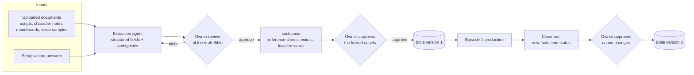
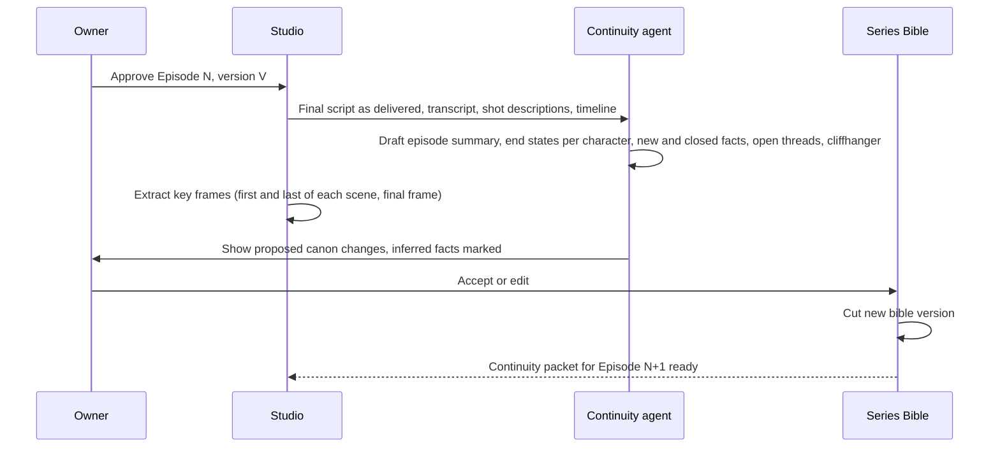

# Character, voice and continuity system

Status: planning draft, 26 November 2026.

This is the part of the studio that makes Episode 7 look and sound like Episode 1. It covers the Series Bible, how characters and voices are locked, how references are chosen for each generation, how story memory is kept, and how a finished episode feeds the next one. Table and column names refer to DATABASE_AND_DATA_MODELS.

## 1. What goes wrong today, and what this system must prevent

These are failures seen while making Madhopur Episode 1 and the earlier SpeakX films, or warned about in the Madhopur production briefs. Each one maps to a mechanism below.

| Failure | Cause | Mechanism that prevents it |
|---|---|---|
| A character's face drifts between clips | Each clip was prompted from text plus one loose image | Locked looks with a fixed reference set per angle (§3) and a face-similarity gate (§8) |
| Devendra's shirt changed between scenes | Wardrobe lived in prompt prose, not in data | Wardrobe as a dated `continuity_fact`, injected into every unit (§5) |
| Spacecraft silhouette changed with angle | No approved views of the prop | Approved `location_view` and prop views, referenced by ID (§4) |
| A line delivered in the wrong voice or accent | Native model audio picks its own voice | Dialogue always replaced or converted to the character's locked voice (§6) |
| Names mispronounced ("Devendra", "Madhopur") | No pronunciation memory | Per-voice pronunciation dictionary (§6.3) |
| A child shown in a way the rules forbid | Rules were in a person's head | `protected` flag plus a hard content policy in prompt assembly and QC (§7) |
| Next episode starts from the MP4 only | No structured end state | Episode close-out writes end states, key frames and facts (§9) |

## 2. The Series Bible

The Series Bible is the single approved description of the series. It is not one document: it is a versioned set of records (characters, looks, voices, locations, props, style guide, world rules, continuity facts) with a snapshot per version (`bible_version`).



Rules:

1. The extraction agent fills structured fields from the documents and lists every ambiguity as a question. It never invents an age, a relationship or a backstory to fill a gap. In autonomous mode it may propose values, and each one is marked `inferred` until the owner accepts it.
2. Nothing generates final footage against a draft Bible. Cheap reference images are allowed during the lock pass.
3. A locked record can only change through a new bible version that the owner approves.

## 3. Character identity

### 3.1 Identity versus looks

A `character` is permanent: name, being, role, personality, age statement, protection flag, voice. A `character_look` is how that character appears for a stretch of story: an age, a costume, a state. Veer at five in a kurta and Veer at seventeen in a school uniform are two looks of one character. The second is derived from the first so the face carries across.

### 3.2 The reference set

Every approved look has this reference set before it is used in a final clip:

| Reference | Purpose |
|---|---|
| Front portrait, neutral light | Identity anchor for face-similarity checks |
| Three-quarter left and right | Most common shot angles |
| Profile | Side shots, walking shots |
| Full body, front and back | Height, build, wardrobe |
| Character sheet (one image with several angles) | The single image most video models accept best as a reference |
| 3 to 5 expressions (neutral, fear, joy, anger, tears) | Emotional scenes |
| Wardrobe flat-lay or detail | Fabric, pattern, accessories |

Madhopur already has character sheets with provider job IDs for Suman, Devendra, Veer, Meera and Yash. Those import as approved looks without regeneration.

### 3.3 Reference selection per generation unit

Video models accept a limited number of reference images (Seedance 2.0 takes up to nine image references; others take fewer). The prompt assembler chooses, for each generation unit:

1. One sheet or front portrait per character who is on screen, matched to the look valid at that point in the story.
2. The location view that matches the scene's camera direction and hour.
3. Any prop that is touched or featured.
4. For a unit that continues an earlier unit, the last frame of the kept take of that unit as the first frame.

If the references needed exceed the model's limit, the assembler drops in this order: wardrobe detail, second location view, expressions, props not touched. It never drops a face. If two faces plus a location still do not fit, it splits the unit.

### 3.4 Prompt assembly

Prompts are assembled from data, not written freehand each time. The template has fixed sections:

```
[STYLE]       from style_guide (grade, lens, light, film texture)
[LOCATION]    location view description + hour + weather
[CHARACTERS]  per character: look description + wardrobe facts valid now
              + physical-state facts valid now (injury, dirt, wet hair)
[ACTION]      the shot list for this unit, in order, with timings
[CAMERA]      framing, angle, move per shot
[PERFORMANCE] expression notes; "lips closed" when no line is spoken
[RESTRICTIONS] series content policy + protected-person rules + negatives
[REPAIR]      only on a retake: what the previous take got wrong
```

The `[REPAIR]` block comes from the QC diagnosis (QUALITY_CONTROL_FRAMEWORK §6). The end-to-end-video-creation skill already uses this structure; the studio makes it a function with tests.

## 4. World continuity

- **Locations** have fixed features (where the door is, which side the window light comes from) and approved views. A floor plan per key location records camera positions, so the reverse angle matches the wide.
- **Hour and light** belong to the scene and propagate to every unit in it. A scene marked `continues_scene_id` inherits hour, weather and positions.
- **Props** have approved views and an owner. Their state (open hatch, cracked window) is a continuity fact.
- **Screen direction** (who is on the left, which way the pickup tilts) is recorded in the shot plan and checked in QC against the previous shot.

## 5. Narrative memory

Story memory is a table of facts with a validity window (`continuity_fact`), not a pile of text. Each fact has a kind, a subject, a plain sentence, where it became true and where it stopped being true.

Examples from Madhopur:

| Kind | Statement | Valid from | Valid to |
|---|---|---|---|
| physical_state | Devendra wears the checked shirt | E1 S3 | E1 end |
| knowledge | Suman and Devendra have seen the spacecraft | E1 S4 | — |
| knowledge | The boy's name is not yet known to the town | E1 | E2 naming scene |
| relationship | Suman and Devendra will raise the boy | E2 | — |
| open_thread | Who is the teenage boy tied to the post? | E1 S2 | — |
| cliffhanger | The boy holds Suman's hand beside the ship | E1 end | E2 opening |
| world_rule | The ship is cool and neutral in colour against warm earth | Bible v1 | — |

How facts are used:

1. **Before writing a script or plan**, the continuity agent assembles a *continuity packet*: every fact valid at the start of the episode, the previous episode's summary and end states, open threads, and the cliffhanger. This packet, not the previous MP4, is the input.
2. **After a script is drafted**, the continuity agent checks each scene against the packet and flags contradictions (a character who knows something too early, a costume that changes without a reason, a timeline that does not add up).
3. **After an episode is approved**, the close-out step writes new facts and closes old ones (§9).

Why not vector search: a series of 10 to 50 episodes has a few thousand facts at most. Filtering by series, subject and validity window is exact and cheap. A model reading the whole valid set is more reliable than a similarity search that can miss a fact. Vector search is kept for one job only: comparing a generated face or voice to its references.

## 6. Voice continuity

### 6.1 Voice lock

Each speaking character gets one locked voice. The setup creates it in one of three ways:

| Origin | When | Requirement |
|---|---|---|
| Designed from a text description | Default for fictional characters | Owner picks from generated previews |
| Library voice | Quick start | Owner approves |
| Cloned from a recording | Only for a real person who agreed | A stored consent record; the system refuses without it |

Sia's ElevenLabs voice is the first locked voice and is reused unchanged.

### 6.2 How dialogue is produced

Video models with native audio choose their own voice. The studio does not trust that for dialogue. There are two supported paths, chosen per series:

| Path | How | Strength | Weakness |
|---|---|---|---|
| **TTS first, then lip-sync** | Generate the line in the locked voice, then generate or retime the clip so the mouth matches | Voice is exact every time | Lip-sync adds cost per spoken shot; quality varies by provider |
| **Native audio, then voice conversion** | Let the video model speak the line, then convert that speech to the locked voice | Mouth already matches; cheaper | Conversion can lose emotion or mispronounce; must be checked |

Madhopur Episode 1 used native audio and kept dialogue short. The plan keeps both paths and lets the PoC measure which is cheaper per approved second for this series (see the proof of concept in MASTER_IMPLEMENTATION_PLAN).

Lines spoken off screen or with the speaker's back to camera always use TTS directly, with no lip-sync.

### 6.3 Pronunciation and delivery

- A per-voice pronunciation dictionary holds names and Hinglish words with the spelling that the TTS model reads correctly. For Devanagari dialogue the stored text is the Devanagari line plus, where needed, a respelling.
- Delivery notes per line (whisper, shout, breathless) come from the script and are passed to the TTS model as tags or settings.
- Every generated line is transcribed back (ASR) and compared with the script. A mismatch fails the take (QUALITY_CONTROL_FRAMEWORK §4.3).

### 6.4 Voice drift check

Each approved voice has reference samples and a speaker embedding. Every new line is embedded and compared with the reference. A score below the series threshold fails the line. The threshold is calibrated in the PoC on known-good and known-bad lines.

## 7. Protected people and content policy

This is a hard rule set, applied in code, not left to model judgment.

1. A character is `protected` if the script or owner states an age under 18, or if no age is stated and the character could be read as a minor. The extraction agent cannot clear this flag; only the owner can, by stating an adult age.
2. Prompts for protected characters never describe the body beyond clothing and posture, never include undress, and always state the character is fully clothed. The "child never shirtless" rule from Madhopur generalises to this.
3. Protected characters are never placed in romantic, sexual or graphic-violence beats. A script beat that does this is blocked at the script stage, before any generation.
4. QC runs a safety check on every take with a protected character (QUALITY_CONTROL_FRAMEWORK §4.6). A failure here can never be waived by automation; it always goes to a person and the take is not used.
5. Provider moderation blocks are logged as a finding and never retried with weakened wording automatically.

## 8. Measuring consistency

| Check | Method | Applies to |
|---|---|---|
| Face identity | Face embedding of sampled frames versus the look's front and three-quarter references; cosine similarity with a calibrated threshold | Every take with a visible face |
| Wardrobe | Vision-model comparison of sampled frames against the wardrobe facts valid now, answering fixed yes/no questions | Every take with a character |
| Location | Vision-model comparison with the location view; fixed features present and on the correct side | Every take |
| Voice identity | Speaker embedding versus voice references | Every dialogue line |
| Pronunciation | ASR transcript versus script, with name list | Every dialogue line |
| Story facts | Continuity agent reviews the script and the final cut's transcript and shot descriptions against the packet | Script and final episode |

Thresholds start from defaults and are calibrated during the PoC on Madhopur takes that were already accepted and rejected by a person.

## 9. Episode close-out and the next episode

When the owner approves an episode, a close-out step runs:



Episode N+1 then starts from the continuity packet, the approved looks, the key frames and the voices. Its opening scene, if it continues the cliffhanger, uses the final frame of Episode N as a first-frame reference.

## 10. What already exists and is reused

| Existing piece | Reuse |
|---|---|
| Madhopur character sheets and job IDs | Imported as approved looks |
| Continuity bible JSON from the short-drama preset (characters, locations, props, scenes, clips, looks) | Its fields map onto the tables; an importer converts it |
| `card_style.json` and the cut list for Episode 1 | Imported into the style guide and the timeline |
| Character passports and room frames from the end-to-end-video-creation skill | Become the reference-set and floor-plan conventions |
| Sia voice and the speech plus lip-sync recipe | First locked voice; first lip-sync provider adapter |
| The `check.py` age-quote rule | Becomes the `protected` flag logic |
