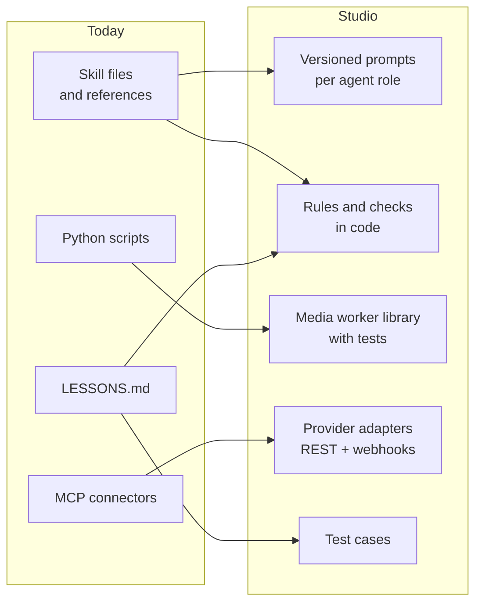

# Claude skills integration

Status: planning draft, 26 November 2026.

This document records what was found in the existing skills, tools and connectors, and how each is used by the studio: reused as code, turned into prompts and rules, kept as a manual tool, or not used.

## 1. Key constraint

The skills and connectors used so far run inside Claude Code on one person's machine, signed in as that person. A backend service cannot call them: skills load only from a filesystem inside a Claude Code or Agent SDK session, and claude.ai connectors cannot be reused with an API key. The studio therefore **ports** what the skills know into its own code and prompts, and **calls providers directly**.

This is good for the product. Knowledge that today lives in long skill files becomes tested functions, versioned prompts and data.

## 2. Audit of what exists

### 2.1 Local skills

| Skill | What it contains | Studio use |
|---|---|---|
| `end-to-end-video-creation` | Full film pipeline; board-before-video; floor plans; passports and room frames; unit prompts with repair block; 480p test takes; finish (upscale, grain, colour); rescue by crop and blur; cost per kept second. Scripts: `assemble.py`, `burn_captions.py`, `captions_from_timeline.py`, `transcribe_words.py`, `verify_final.sh`, `board.py`, `animatic.py`, `floor_plan.py`, `finish.py`, `shot_colour.py`, `cost_log.py`, `reframe.py` | **Main source.** Scripts become the media worker library. References become the planner's and judges' rules |
| `cinematic-ad-film` | The earlier version of the above, for SpeakX ad films | Superseded by the above; kept for history |
| Higgsfield `/short-drama` preset (via MCP) | `plan.json` with revisions; `check.py` gates (plan, pictures, clips, film, edit); quote-then-price money rules; "More episodes" via previous plan; protected-person age-quote rule; edit kinds; continuity bible JSON; editor scripts `render.py`, `subs.py`, `edl_check.py` | Gates become pre-generation QC. Continuity bible JSON gets an importer. Money rules become the budget ledger. Editor scripts join the media library where licensing allows; otherwise their behaviour is re-implemented |
| `claude-api` | Current Claude API guidance | Used while building the agent layer |
| Design, data and productivity skills | Unrelated to production | Not used |

### 2.2 Connectors used to make Episode 1 and the prototype

| Connector | Used for | Studio use |
|---|---|---|
| Higgsfield MCP | Images, Seedance clips, sandbox editing, video analysis | Replaced by the Higgsfield REST API. Stays the fastest manual tool for experiments |
| ElevenLabs connector | Sia's voice, dubbing, HeyGen lip-sync through Flows | Replaced by the ElevenLabs REST API and the HeyGen API |
| Eddie (heyeddie.ai) | Edit help | No API for unattended use. Not in the pipeline |
| Pletor, Canva, Figma, Gamma | Design and docs | Not in the pipeline. Figma may hold the studio's UI design |

### 2.3 Lessons already written down

`LESSONS.md` and the memory notes record working recipes: Hinglish subtitles need Hindi ASR settings, child characters are never shown shirtless, faces need room in the 9:16 frame, the black tail of a clip must be cut before the next screen, lip-sync costs about 5,450 to 6,670 ElevenLabs credits per 8 to 10 s of Sia. Each lesson becomes a rule, a check, or a test case. §4 lists them.

## 3. Porting plan

| Port | From | To | Effort |
|---|---|---|---|
| Media library | The skill scripts | Python package with a CLI and unit tests, called by media workers | 4–6 days |
| Gates | `check.py` logic | Plan validator and pre-generation checks | 2–3 days |
| Prompt template and repair block | Skill references | Prompt assembler with snapshot tests | 2 days |
| Continuity importer | Short-drama continuity JSON, Madhopur sheets and job IDs | Bible import script | 2 days |
| Cut list to timeline | Episode 1 cut list | Timeline schema converter | 1 day |
| QC checklist | `qc-checklist`, `verify_final.sh` | Tier 1 and Tier 3 checks | 2–3 days |

## 4. Lessons turned into rules

| Lesson | Rule or check |
|---|---|
| Child never shirtless | Protected-person policy in prompts and the safety judge |
| Age must be quoted from the script | `protected` flag set from the script's own words |
| Names cut off on phone screens | Safe-area check for faces and text in 9:16 |
| Black frames at the end of a clip | Tier 1 black-frame check; trim before assembly |
| Hinglish subtitles came out wrong with default ASR | Subtitles from script text plus forced alignment; ASR only to check |
| Dub line verified by transcription | Words check on every line |
| A freeze frame landed on hands | Hold frames chosen by the editor with a face check |
| Long sandbox renders timed out | Media work runs in background jobs with progress, never in a request |
| Corrupt MP4 from an interrupted write | Write to a temporary path, verify, then move |

## 5. Keeping skills useful for people

The skills stay as the way a person uses Claude Code to experiment. When the studio exists, a new project-level skill can teach Claude Code how to drive the studio's own API (start an episode, read QC, submit a revision). That skill is optional and comes after Phase 6.
