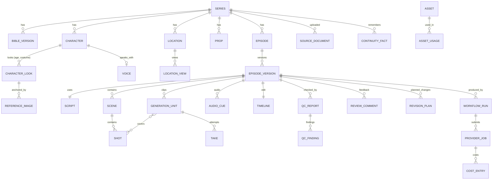
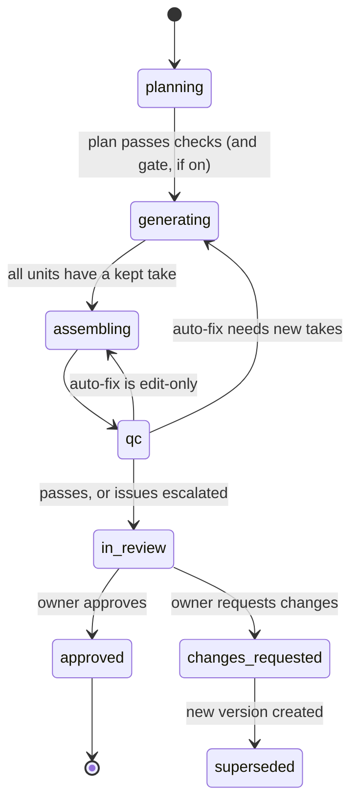

# Database and data models

Status: planning draft, 26 November 2026. Nothing here is built yet.

This document defines what the studio stores, how records relate, and how versions and workflow state are kept. The names used here are the names every other document uses.

## 1. Principles

1. **Postgres is the source of truth.** Every fact the pipeline needs (who a character is, which take was kept, what an episode cost) is a row, never something that lives only in a model's context or in a file name.
2. **Files are immutable and content-addressed.** A file is stored once under the hash of its bytes. Rows point at files; nothing overwrites a file.
3. **Nothing approved is ever updated in place.** Changes create a new version row. "Current" is a pointer.
4. **Permanent attributes and temporary states are different tables.** A character's face is permanent. The cut on her forehead in Episode 3 is a state with a start and an end.
5. **Every generated thing records how it was made**: provider, model, exact request, references used, cost, and the pipeline version that asked for it. This is what makes selective regeneration and cost tracking possible.
6. **Estimated and verified costs are separate columns**, never mixed.

## 2. Entity overview



## 3. Series level

### `series`
| Column | Type | Notes |
|---|---|---|
| id | uuid pk | |
| slug, name | text | "madhopur-ka-raaz" |
| status | enum | `setup`, `bible_review`, `in_production`, `paused`, `complete` |
| production_mode | enum | `script_driven` (A), `ai_assisted` (B), `autonomous` (C) |
| config | jsonb | The answers from the setup wizard: genre, audience, language, aspect ratio, target duration, visual style, pacing, content restrictions. Validated against a schema. |
| current_bible_version_id | fk | The approved Series Bible in force |
| budget_series_cents, budget_episode_cents | int | Hard caps; null means no cap |
| approval_gates | jsonb | Which stages pause for a person (see WORKFLOW_DESIGN) |

### `source_document`
Every uploaded file (Markdown, PDF, image, audio, video). Columns: `id, series_id, asset_id, kind, title, uploaded_by, parsed_at, parse_report jsonb`. The parse report lists what was extracted and what was ambiguous.

### `bible_version`
An immutable snapshot of the whole Series Bible. Columns: `id, series_id, version int, status (draft|approved|superseded), created_from (ingest|episode_approval|manual_edit), change_summary, approved_by, approved_at, snapshot jsonb`.

The snapshot holds the IDs and version numbers of every character, look, voice, location, prop and style rule in force. A new bible version is cut when (a) the setup is approved, (b) an episode is approved and adds or changes canon, or (c) the owner edits canon by hand. Every episode version records the bible version it was produced against.

### `style_guide`
One row per bible version: visual style, cinematography rules, colour grade, lighting, editing style, music palette, sound rules, subtitle and card style. Stored as validated JSON plus the reference assets (look frames, LUT, card style). Madhopur's `card_style.json` is an example of what goes here.

## 4. Character, voice, world

### `character`
Permanent identity. One row per person or creature, for the life of the series.

| Column | Notes |
|---|---|
| id, series_id, key | `key` is a stable short name: `suman`, `veer` |
| name, aliases[] | |
| being | `human`, `creature`, `other` |
| role | lead, supporting, minor, crowd |
| age_statement, age_source | The age in the script's or owner's own words and where it came from. Never invented by a model. |
| protected | bool. True for anyone under 18, of unstated age, or not clearly an adult. Drives the content policy (see CHARACTER_VOICE_CONTINUITY_SYSTEM §7). |
| personality, mannerisms, movement_style, speech_style | text |
| relationships | jsonb: `[{to: character_id, relation, since_episode}]` |
| locked | bool. When true, any change needs explicit owner approval and cuts a new bible version. |
| voice_id | fk to `voice` |

### `character_look`
A character at a point in the story: an age, a costume, a physical state. The unit that reference images attach to.

| Column | Notes |
|---|---|
| id, character_id, key | `veer_age5_kurta`, `veer_age5_checked_shirt`, `veer_age17_school` |
| kind | `base` (the canonical look) or `variant` (derived from a base) |
| derived_from_look_id | For variants and aged versions |
| description | Face, body, height, skin, hair, wardrobe, accessories, in words |
| prompt_positive, prompt_negative | Approved prompt text, per provider if they differ: `{provider: text}` |
| provider_settings | jsonb: model-specific reference settings |
| status | `draft`, `approved`, `retired` |
| first_episode, last_episode | Where this look is valid |

### `reference_image`
`id, look_id (or location_view_id / prop_id), asset_id, angle (front|three_quarter|profile|back|full_body|expression:<name>|sheet|flatlay), provider_handle jsonb, approved bool`.

`provider_handle` stores the ID the provider knows the image by (for example a Higgsfield job or media ID), so later requests reference it without re-uploading. Madhopur's sheets already have these IDs.

### `voice`
| Column | Notes |
|---|---|
| id, series_id, character_id | |
| provider, provider_voice_id | For example `elevenlabs` and the provider voice ID |
| origin | `designed` (made from a text description), `library` (a stock voice), `cloned` |
| consent_record_asset_id | Required when `origin = cloned`. The system refuses to use a cloned voice without it. |
| language, accent | |
| settings | jsonb: model, stability, similarity, style, speed |
| delivery_notes | Tone, emotional range, pacing |
| pronunciations | jsonb: `[{written, spoken_as}]`, for names and Hinglish words |
| reference_audio_asset_ids | Approved sample lines used for similarity checks |
| embedding | vector: speaker embedding of the approved samples (for QC) |
| locked | bool |

### `location`, `location_view`, `prop`
`location`: `id, series_id, key, name, description, period, architecture, fixed_features (doors, windows, light sources), map_asset_id`.
`location_view`: one approved angle of a location with a time of day and lighting: `id, location_id, key (wide|reverse|detail:<x>), hour, light, weather, reference asset, provider_handle`.
`prop`: `id, series_id, key, name, description, scale_notes, owner_character_id, reference asset`.

## 5. Narrative memory

### `continuity_fact`
The structured record of what is true in the story, and from when to when.

| Column | Notes |
|---|---|
| id, series_id | |
| subject_type, subject_id | character, location, prop, relationship, plotline, world |
| kind | `event`, `knowledge` (who knows what), `emotional_state`, `physical_state` (injury, appearance), `wardrobe`, `position` (where someone or something is), `object_state`, `relationship`, `open_thread`, `cliffhanger`, `world_rule`, `established_fact` |
| statement | One sentence in plain words |
| data | jsonb for structured values (for example `{holder: "meera", object: "pendant"}`) |
| permanence | `permanent` or `temporary` |
| valid_from | `{episode, scene, t}` where it became true |
| valid_to | null while true; set when it stops being true |
| story_time | In-story date or offset, for chronology |
| source | `script`, `approved_episode`, `owner`; plus the episode version and line or timestamp |
| confidence | `stated` (in the script or on screen) or `inferred` (a model's reading). Inferred facts are shown to the owner at approval. |
| supersedes_id | When a fact replaces an earlier one |

Querying "what is true at the start of Episode 4" is a filter on `valid_from <= start AND (valid_to IS NULL OR valid_to > start)`.

### `episode_summary`
Written when an episode is approved: scene-by-scene summary, final dialogue as delivered, end state of each character (location, wardrobe, emotion), the cliffhanger, and the key frames (first and last frame of each scene, final frame of the episode) as asset IDs.

## 6. Episode level

### `episode`
`id, series_id, number, title, status, approved_version_id, budget_cents`.
Status: `awaiting_script`, `script_review`, `in_production`, `auto_qc`, `in_review`, `revising`, `approved`, `exported`.

### `episode_version`
One row per version shown or produced. Immutable once it reaches `in_review`.

| Column | Notes |
|---|---|
| id, episode_id, version int | "Episode 1 · Version 3" |
| parent_version_id | The version this one was revised from |
| bible_version_id | Canon it was made against |
| script_id | |
| plan_id | The production plan (scenes, shots, generation units) |
| timeline_id | The edit |
| render_asset_id, preview_asset_id | Final MP4 and review proxy |
| status | `planning`, `generating`, `assembling`, `qc`, `in_review`, `changes_requested`, `superseded`, `approved` |
| change_summary | What differs from the parent, in words and as a list of changed unit IDs |
| pipeline_version | Git SHA of the studio code and prompt set |
| cost_estimated_cents, cost_actual_cents | Roll-ups |

### `script`
`id, episode_id, version, source (owner|ai_draft), text, parsed jsonb (scenes, lines with stable line IDs), approved_at`.
Every dialogue line gets a stable `line_id`. Subtitles, audio cues and QC all refer to it.

### `scene`, `shot`
`scene`: `id, plan_id, index, location_view_id, hour, time_marker, continues_scene_id, characters_present[], states_in jsonb, states_out jsonb, beats jsonb, target_seconds`.
`shot`: `id, scene_id, index, framing, angle, camera_move, subjects[], blocking, expression_notes, lighting, target_seconds, line_ids[], sfx_notes, transition_in, transition_out, storyboard_asset_id`.

### `generation_unit`
The thing actually sent to a video model. Current models make one clip of 4 to 15 seconds that may contain several shots, so a unit covers one or more shots.

| Column | Notes |
|---|---|
| id, plan_id, key | `c1` … `c7` |
| shot_ids[] | Shots it covers, in order |
| method | `t2v`, `i2v_first_frame`, `first_last_frame`, `reference`, `extend`, `v2v_edit` |
| depends_on_unit_id | Set when this unit extends or starts from another unit's last frame. This is the dependency edge used by selective regeneration. |
| references | jsonb: look, location view and prop IDs with roles |
| prompt | The full prompt text |
| negative, restrictions | |
| seconds, resolution, aspect | |
| kept_take_id | The take the timeline uses |

### `take`
One attempt at a generation unit. `id, unit_id, n, provider_job_id, asset_id, status (pending|ok|failed|blocked|rejected_by_qc|superseded), request jsonb (exact payload), seed, draft_of_take_id, qc_summary jsonb, created_reason (initial|auto_fix|owner_feedback)`.

Takes are never deleted. A rejected take stays available for comparison and for the cost of failed generations.

### `audio_cue`
`id, episode_version_id, kind (dialogue|ambience|sfx|music|voiceover), line_id, character_id, voice_id, asset_id, start_ms, end_ms, gain_db, source (native|tts|voice_converted|library|generated), provider_job_id, words jsonb (word timestamps)`.

### `timeline`
The machine-readable edit. One JSON document per episode version, schema-validated, plus an index table for querying.

```json
{
  "fps": 24, "width": 1080, "height": 1920,
  "video": [
    {"id": "seg_04", "take_id": "…", "in": 2.542, "out": 14.958,
     "shot_ids": ["s2_sh3","s2_sh4"], "transition_in": "cut",
     "grade": "ep_default", "reframe": null, "note": "trimmed still head"}
  ],
  "audio": [
    {"track": "dialogue", "cue_id": "…", "at": 13.82, "gain_db": 0},
    {"track": "music", "cue_id": "…", "at": 61.0, "gain_db": -18, "duck_under": "dialogue"}
  ],
  "overlays": [
    {"type": "name_card", "text": "DEVENDRA", "at": 38.1, "dur": 2.6, "style": "series_card"},
    {"type": "subtitle", "line_id": "e1_l4", "at": 79.47, "dur": 1.0}
  ],
  "mix": {"target_lufs": -14, "true_peak_db": -1.5}
}
```

Madhopur's `cut-list.json` (segments with clip, in, out and a note; cards; subtitles) is the same idea and maps onto this schema directly.

`timeline_segment` (index table): `timeline_id, seg_id, take_id, t_start, t_end, shot_ids[]`. This is how a timestamp in a review comment is resolved to a shot, a take and a generation unit.

## 7. Quality, review, revision

`qc_report`: `id, episode_version_id, scope (take|scene|episode), pass bool, score jsonb, created_at`.
`qc_finding`: `id, report_id, check_key, severity (critical|major|minor|info), target (unit|take|cue|segment|episode), t_start, t_end, evidence jsonb (frames, measurements), diagnosis, suggested_action, status (open|auto_fixed|escalated|waived), fixed_by_take_id`.
`review_comment`: `id, episode_version_id, author, t_start, t_end, region jsonb (x,y,w,h normalised), category, text, attachment_asset_ids[], status (open|planned|applied|declined)`.
`revision_plan`: `id, from_version_id, to_version_id, status (proposed|approved|running|done), actions jsonb, estimated_cost_cents, bible_impact jsonb`.
`revision_action` (rows of the plan): `id, plan_id, comment_ids[], finding_ids[], type (see VIDEO_EDITING_AND_REVISION_ENGINE §4), target ids, params, depends_on[], est_cost_cents, result`.
`approval`: `id, subject_type, subject_id, gate, decision, by, at, note`.

## 8. Assets

### `asset`
| Column | Notes |
|---|---|
| id | uuid |
| sha256 | Unique. The storage key is derived from it. |
| kind | image, video, audio, document, timeline, lut, subtitle |
| mime, bytes, width, height, duration_ms, fps | Probed on ingest, never trusted from the provider |
| storage_key | `s3://studio-assets/<series>/<sha256[0:2]>/<sha256>` |
| origin | `upload`, `generated`, `derived` (rendered or transformed by us) |
| derived_from[] | Parent assets |
| provider_job_id | If generated |
| series_id | Assets are isolated per series; sharing needs an explicit `asset_share` row |
| rights | jsonb: licence or consent notes |
| created_by | user or workflow run |

`asset_usage`: `asset_id, used_by_type, used_by_id, episode_version_id`. This powers "where is this used", reuse savings, and safe garbage collection (an asset used by any approved version is never collected).

## 9. Workflow and cost

`workflow_run`: `id, kind (series_setup|episode_production|revision|post_approval), subject ids, engine_run_id, status, current_stage, started_at, ended_at, error`.
`stage_run`: `id, workflow_run_id, stage, attempt, status, input_hash, output_ref, started_at, ended_at`. The input hash makes stages resumable and skippable when nothing changed.
`provider_job`: `id, workflow_run_id, provider, model, operation, idempotency_key (unique), request jsonb, status, provider_ref, submitted_at, finished_at, error_code, error_message, refunded bool`.
The idempotency key is a hash of provider, model and the normalised request. Submitting the same request twice returns the existing job. This is the duplicate-generation guard.
`cost_entry`: `id, provider_job_id (or llm_call_id), series_id, episode_version_id, unit_id, category (image|video|voice|music|sfx|lipsync|upscale|llm|render|storage), reason (initial|auto_fix|owner_revision|failed|test), estimated_cents, actual_cents, credits, credit_rate_cents, verified bool, verified_source`.
`llm_call`: `id, role, model, input_tokens, output_tokens, cache_read_tokens, cache_write_tokens, cents, stage_run_id`.
`budget_ledger`: running totals per series and episode, updated in the same transaction as `cost_entry`, checked before every paid submission.
`event_log`: append-only audit trail of state changes, approvals and bible edits.

## 10. State machines

Episode version:



Take: `pending → ok | failed | blocked`; `ok → rejected_by_qc | superseded`. Provider job: `queued → submitted → running → succeeded | failed | cancelled | timed_out`, with `refunded` as a flag.

## 11. Version control rules

- An episode version, its plan, its timeline and its kept takes are frozen when it reaches `in_review`.
- A revision creates a new episode version that **copies pointers, not files**: unchanged units point at the same takes and assets.
- "Restore Version 2" creates Version N+1 whose pointers equal Version 2's. History is never rewritten.
- Comparing versions is a diff of two timelines and two sets of kept takes; the UI renders it side by side.
- Bible changes follow the same rule: a new `bible_version`, never an update.

## 12. Indexing, retention, backup

- Indexes: `timeline_segment (timeline_id, t_start, t_end)`, `continuity_fact (series_id, subject_id, valid_to)`, `provider_job (idempotency_key)`, `asset (sha256)`, `cost_entry (episode_version_id, category)`.
- Vector index only on `voice.embedding` and on reference-image embeddings used by QC. Story memory does not need vector search at this scale (see CHARACTER_VOICE_CONTINUITY_SYSTEM §6).
- Retention: assets used by an approved version are kept indefinitely. Rejected takes are kept for 90 days by default, then moved to cold storage, configurable per series.
- Backup: managed Postgres point-in-time recovery, a nightly logical dump to object storage, and bucket versioning on the asset store. A restore drill is part of the acceptance tests.
