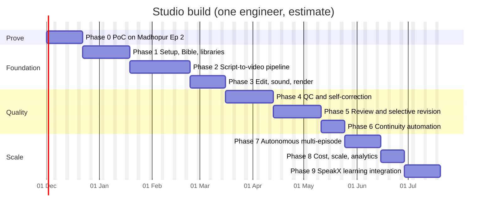
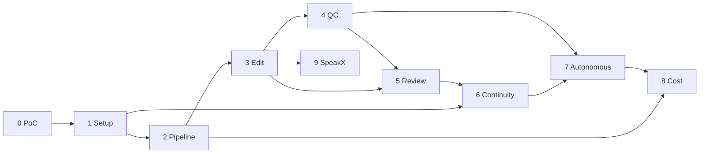

# Implementation roadmap

Status: planning draft, 26 November 2026. Effort is in working weeks for one full-stack engineer building with Claude Code, plus the owner's review time. Two engineers shorten the calendar by roughly a third, not by half.

## 1. Changes to the phase order in the brief

The brief's nine phases are kept, with three changes:

1. **Phase 0 is added: a proof of concept** that settles the open technical questions (provider resolution and price, identity checks, voice path, auto-fix rate) on Madhopur Episode 2 before the full build. Building nine phases on unproven assumptions is the biggest risk to the plan.
2. **The continuity data model is built in Phase 1, not Phase 6.** Memory cannot be added later without migrating every record. Phase 6 then adds the automated close-out and continuity checks on top.
3. **Basic QC ships with the pipeline in Phase 2**, because an unchecked pipeline spends money on bad takes. Phase 4 adds the full judge panel and self-correction.

"Using existing skills" in Phase 2 means porting their scripts and rules into the studio (CLAUDE_SKILLS_INTEGRATION). A backend cannot call the skills or the signed-in connectors directly.

## 2. Phases

Dates assume a start on 1 December 2026 and working days only; they move with the approval date.

| Phase | Scope | Exit criteria | Effort |
|---|---|---|---|
| **0. Proof of concept** | Scripts and notebooks, no UI. Provider accounts and keys. Higgsfield API resolution test. Import Madhopur Bible. Plan, generate, check and assemble Episode 2 semi-automatically. Calibrate face and voice checks. Measure auto-fix rate and cost per approved second | TESTING_AND_ACCEPTANCE_CRITERIA §4 met, or a written decision on what to change | 3 weeks |
| **1. Series setup and libraries** | Repo, CI, Postgres schema, storage, auth. Setup wizard, document ingest, Bible review, character looks and reference sets, voice library, locations and props, continuity fact store, Bible versions, asset library | Madhopur Bible built through the UI; versions and approvals work | 4 weeks |
| **2. Screenplay-to-video pipeline** | Inngest workflows; provider adapters (Higgsfield, ElevenLabs, sync.so, HeyGen, fal); script parsing; planner; pre-visualisation; generation with Tier 1 and basic Tier 2 checks; budget ledger and idempotency; production monitor | An episode's takes generated unattended from an approved script, within budget, with failures handled | 5 weeks |
| **3. Editing, sound, rendering** | Timeline schema and validator; edit agent; audio cues and mix; subtitles and cards; proxy and master renders; finish pass; exports | A complete episode rendered from takes with no manual editing; export checks pass | 3 weeks |
| **4. QC and self-correction** | Full judge panel; audio checks; Tier 3 checks; findings and actions; self-correction loop with limits; calibration tooling and dashboards | Calibration targets met; ≥ 60% of major findings fixed automatically on a test episode | 4 weeks |
| **5. Review and selective revision** | Review screen; timestamp and region comments; revision analyst; dependency graph; revision plans with cost; version compare, restore, cherry-pick | Acceptance rows for review, revision and versions met | 4 weeks |
| **6. Continuity automation** | Close-out workflow; automatic facts and end states; continuity packet; continuity checks on scripts, plans and cuts | Episode N+1 plan uses Episode N close-out automatically; planted contradictions caught | 2 weeks |
| **7. Autonomous multi-episode production** | Modes B and C; showrunner role; series arc tracking; queued episodes; gates for budget, safety and canon | Three consecutive test episodes made in mode C with owner review only at the end | 3 weeks |
| **8. Cost, scale, analytics** | Provider routing by cost; draft-first tuning; reconciliation; analytics on cost, retakes and QC; load test with 3 series at once | Cost per approved second down ≥ 20% from Phase 2 baseline; reconciliation within 5% | 2 weeks |
| **9. SpeakX learning integration** | Export package; learning-layer workflow that extracts sentences, builds questions and scene clips, and generates Sia's intervention after the cliffhanger, in the SpeakX repository | One episode published into the prototype flow automatically | 3 weeks |
| **Total** | | | **about 33 weeks (8 months)** for one engineer; about 5 to 6 months with two |

A usable internal studio (Phases 0 to 3: set up a series, make an episode unattended, review the cut manually) is about 15 weeks.

## 3. Dependencies

Phase 9 depends only on the export package from Phase 3, so it can start earlier in parallel with a second engineer.

## 4. Working method

- Each phase starts with a short design note and ends with a demo on Madhopur and a written sign-off from the owner.
- Work happens on feature branches; the `nishtha` branch holds planning and the PoC; `main` keeps the live prototype.
- Each phase has a spend cap for live provider tests, agreed before it starts.
