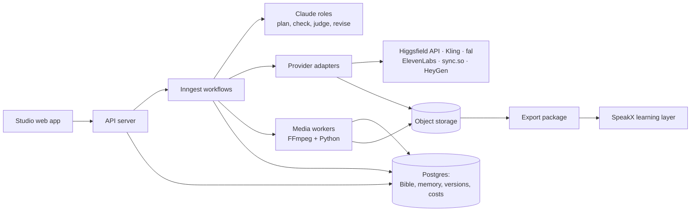
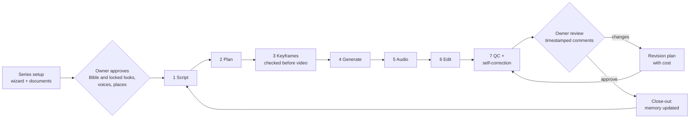

# AI Series Studio: master implementation plan

Status: **draft for owner approval**, 26 November 2026. Nothing is built yet. Building starts only after this plan is approved, one phase at a time.

## 1. What this is

A web studio that turns a series idea and its documents into finished vertical episodes with consistent characters, voices and story, checks its own work, fixes most problems by itself, and lets the owner review with timestamped comments that are fixed precisely and cheaply. Madhopur (मधोपुर का राज़) is the first series and the proof of concept. The SpeakX learning layer consumes finished episodes but stays a separate product.

## 2. Verdict on feasibility

**Feasible, with one owner checkpoint per episode, and with two technical questions that the proof of concept must settle first.**

- Every generation step has a usable asynchronous API with webhooks: video (Higgsfield API with Seedance 2.0 and Kling, Kling direct, fal), images, voices (ElevenLabs, Cartesia), lip-sync (sync.so, HeyGen), upscale (Topaz via fal).
- Durable workflow engines (Inngest recommended) handle long waits, fan-out and per-provider limits.
- Editing and rendering are deterministic with FFmpeg and the scripts that already exist.

The two uncertain areas:

1. **Character consistency** across many clips and episodes. References, keyframe checks and face-similarity gates reduce drift, but the real rate must be measured.
2. **Automated visual QC.** Narrow judges with calibration can catch most defects. Taste stays with the owner, so the owner's final review is kept.

Three facts from verification change the brief's assumptions. The tools used to make Episode 1 (Higgsfield and ElevenLabs connectors, Claude Code skills) cannot be called by a backend, so their knowledge is ported into the studio and providers are called by REST API. Veo 3.1 left the Gemini API and restricts child content on Vertex AI. Google Flow has no API.

## 3. Recommended architecture

- **Claude is the reasoning layer inside workflow steps**: parsing, planning, continuity checks, eight narrow judges, editing decisions, revision analysis. It never owns the loop, the budget or the approvals.
- **Postgres is the memory**: Series Bible, character looks and voices, dated continuity facts, plans, takes, timelines, QC findings, comments, versions and costs.
- **Every episode starts from a continuity packet** built from that memory, not from the previous MP4.
- **The revision engine** maps each comment to segments, takes and generation units, picks the cheapest fix, and redoes only what depends on the change.

Details: SYSTEM_ARCHITECTURE, DATABASE_AND_DATA_MODELS, AI_AGENT_ARCHITECTURE.

## 4. Recommended workflow

Three production modes: script-driven (Madhopur), AI-assisted, autonomous. Details: WORKFLOW_DESIGN.

## 5. What exists and what must be built

### 5.1 Reusable now

| Capability | Source |
|---|---|
| Film pipeline knowledge: board before video, passports, room frames, repair prompts, draft takes, finish pass | end-to-end-video-creation skill |
| Media scripts: assemble, captions, word transcription, verify, board, animatic, floor plan, finish, colour, reframe, cost log | Same skill |
| Pre-generation gates, money rules, continuity bible format, protected-person rule | Higgsfield short-drama preset |
| Madhopur references: character sheets, locations, props, and the craft reference, with job IDs | Episode 1 runs |
| Episode 1 cut list, card style, subtitles; final Episode 1 video | Repository |
| Sia's locked voice and the speech plus HeyGen lip-sync recipe | ElevenLabs account |
| Learning-layer prototype (questions, Sia, rewards) | `prototype/` |
| Working lessons (safe areas, black tails, Hinglish subtitles, child-safety rule) | LESSONS.md and notes |

### 5.2 To build

Web app; database and storage; Inngest workflows; provider adapters; ingest and Bible editor; prompt assembler; planner; keyframe stage; budget ledger and idempotency; audio pipeline with alignment; timeline schema, validator and renderer service; QC checks and judge panel with calibration; self-correction loop; review screen; revision engine with dependency graph; version compare and restore; close-out and continuity packet; cost dashboards; export package.

## 6. Proof of concept: Madhopur Episode 2

**Episode 2, "आज से ये हमारा बेटा है" (1:50)**: the kitchen at night, a growing-up montage, the school gate, the river bridge. It is a strong test because it continues straight from Episode 1's ending, introduces new looks of Veer as he grows (a derived look), adds new locations, and its dialogue includes the line the master document asks to test ("आज से ये हमारा बेटा है, देवेंद्र।").

It also contains a real continuity trap. The revised Episode 1 removed the post scene and made the craft massive, which affects later episodes. The continuity checks must flag those knock-on changes.

### 6.1 How it runs

No studio UI yet. Scripts and notebooks against the real providers, three weeks:

1. **Week 1.** Set up provider API accounts and keys. Run the Higgsfield API resolution and price test. Import the Madhopur Bible from the Episode 1 continuity JSON and job IDs. Build the calibration set from Episode 1's kept and rejected takes. Calibrate the face and voice checks.
2. **Week 2.** Parse the Episode 2 script. Build the continuity packet. Plan, make keyframes, check them, generate takes, run Tier 1 and Tier 2 checks with automatic retakes inside a cap. Try both dialogue paths on the kitchen scene: TTS then lip-sync, and native audio then voice conversion.
3. **Week 3.** Assemble, mix, subtitle and render. Run Tier 3 checks. The owner reviews and leaves comments. Run one selective revision. Write the results report.

### 6.2 Success criteria

| # | Criterion | Target |
|---|---|---|
| 1 | Inputs to every step come from the Bible and Episode 1 close-out, not the MP4 | 100%, logged |
| 2 | Face identity for Suman, Devendra and Veer | ≥ 90% of face frames above the calibrated threshold |
| 3 | Voice identity and names | 100% of kept lines pass |
| 4 | Story contradictions with Episode 1 found by the owner | 0 |
| 5 | Owner hands-on time, start to approval | < 90 minutes |
| 6 | Major QC findings fixed automatically | ≥ 60% |
| 7 | A three-comment revision changes only the targeted segments | Yes |
| 8 | Generation spend | Within the approved PoC cap |
| 9 | Safety findings in the approved version | 0 |
| 10 | Owner's verdict | As good as or better than Episode 1 |

### 6.3 Outputs

Episode 2 master and subtitled master; the measured cost per approved second; the generated-to-approved ratio; the QC calibration report; the comparison of the two dialogue paths; and a go, change or stop recommendation for Phase 1.

### 6.4 Budget

| Item | Estimate |
|---|---|
| Video generation (about 330 s generated for 110 s on screen, Seedance 2.0 on the Higgsfield API) | $27 to $45 |
| Resolution and dialogue-path tests | $15 to $30 |
| New looks, locations and keyframes (about 40 images) | $2 to $4 |
| Voices, lip-sync, upscale | $5 to $10 |
| Claude (planning, judges, calibration) | $15 to $30 |
| Platform (one month, free and low tiers) | $20 to $110 |
| **Proposed PoC cap** | **$150 for generation and Claude, plus platform** |

If the Higgsfield rate turns out to be for low resolution only, the video line could rise several times over (COST_OPTIMISATION_FRAMEWORK §2). In that case the PoC pauses and asks before going on.

## 7. External services

| Service | Role | Account needed |
|---|---|---|
| Higgsfield API (separate from the website plan) | Video (Seedance 2.0 and 2.5, Kling), images (Seedream) | New, prepaid USD |
| ElevenLabs API | Voices, alignment, ASR | Existing account, new scoped key |
| sync.so | Lip-sync | New |
| HeyGen API | Sia clips | New or existing |
| fal | Upscale and fallback models | New, prepaid |
| Kling | Fallback video | Later, if the PoC needs it |
| Anthropic API | Claude roles | New or existing, with spend limit |
| Inngest, managed Postgres, R2/S3, hosting, Sentry | Platform | New, free tiers for the PoC |

## 8. Effort and operating cost

| | Estimate |
|---|---|
| Build effort, Phases 0 to 9 | About 33 engineer-weeks: about 8 months for one engineer, 5 to 6 months for two |
| Usable internal studio (Phases 0 to 3) | About 15 weeks |
| Cost per 95 s episode | About $25 to $60 at Higgsfield API rates; about $175 to $300 if 1080p must come from fal |
| Platform per month | About $20 to $110 for the PoC; about $420 to $1,070 in production |
| Owner time per episode | Target under 90 minutes, after Phase 5 |

All costs are estimates until the PoC measures them. Details: IMPLEMENTATION_ROADMAP, COST_OPTIMISATION_FRAMEWORK.

## 9. Main risks

1. Character drift across clips and episodes.
2. QC that misses defects or rejects good takes.
3. Provider rules on child characters. Madhopur has several.
4. Higgsfield API resolution and price not yet confirmed.
5. Provider churn: models and prices change within months.

Full register: RISKS_AND_LIMITATIONS.

## 10. Build sequence

Phase 0 PoC → 1 setup and libraries (with the memory model) → 2 pipeline with basic QC → 3 edit, sound, render → 4 full QC and self-correction → 5 review and selective revision → 6 continuity automation → 7 autonomous multi-episode → 8 cost and scale → 9 SpeakX integration (can run in parallel after Phase 3).

## 11. Decisions needed from the owner

| # | Decision | Recommendation |
|---|---|---|
| 1 | Approve this plan, or name changes | — |
| 2 | Approve the PoC cap | $150 for generation and Claude, plus platform tiers |
| 3 | Create the provider accounts and keys in §7. Only the owner can create accounts and enter payment details | Higgsfield API, sync.so, fal, Anthropic API first |
| 4 | Master quality: 1080×1920 generated natively, or 720p generated and upscaled | Decide after the resolution test |
| 5 | Dialogue path default | Decide after the PoC comparison |
| 6 | Who builds: one engineer with Claude Code, two engineers, or an agency | One engineer for Phase 0, then decide |
| 7 | Hosting preference and data location (India or anywhere) | Any region for the PoC |
| 8 | Music: licensed library or generated music, after legal review of licences | Licensed library |
| 9 | Is the studio internal only, or a product for outside clients later? This changes accounts, billing and tenancy | Internal first |
| 10 | Episode 2 script: use the master document as written, or update it first for the revised Episode 1 (massive craft, no post scene) | Let the PoC continuity check flag the changes, then the owner edits |

## 12. Document index

| Document | Covers |
|---|---|
| SYSTEM_ARCHITECTURE | Components, workflow engine choice, adapters, security, deployment |
| WORKFLOW_DESIGN | Setup, seven stages, review, close-out, failures, timing |
| CLAUDE_SKILLS_INTEGRATION | Audit of skills and connectors, porting plan, lessons as rules |
| AI_AGENT_ARCHITECTURE | Claude roles, calling pattern, evaluation, model choice, cost |
| CHARACTER_VOICE_CONTINUITY_SYSTEM | Series Bible, looks, voices, narrative memory, close-out, safety |
| DATABASE_AND_DATA_MODELS | Tables, state machines, versioning |
| API_INTEGRATION_PLAN | Providers chosen, auth, async patterns, policies, accounts |
| UI_UX_SPECIFICATION | Screens, review interface, interaction rules |
| VIDEO_EDITING_AND_REVISION_ENGINE | Timeline, assembly, comment to action, dependency graph |
| QUALITY_CONTROL_FRAMEWORK | Checks, judges, actions, self-correction, calibration |
| COST_OPTIMISATION_FRAMEWORK | Cost model, levers, controls |
| TESTING_AND_ACCEPTANCE_CRITERIA | Test layers, invariants, acceptance, PoC criteria |
| IMPLEMENTATION_ROADMAP | Phases, effort, dependencies |
| RISKS_AND_LIMITATIONS | Risks, limits, assumptions, challenges to the brief |
| ../CLAUDE.md | Rules for Claude Code when building |
| research/ | Provider verification notes with sources |
