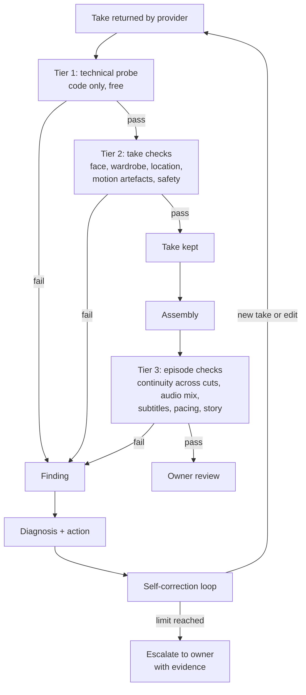
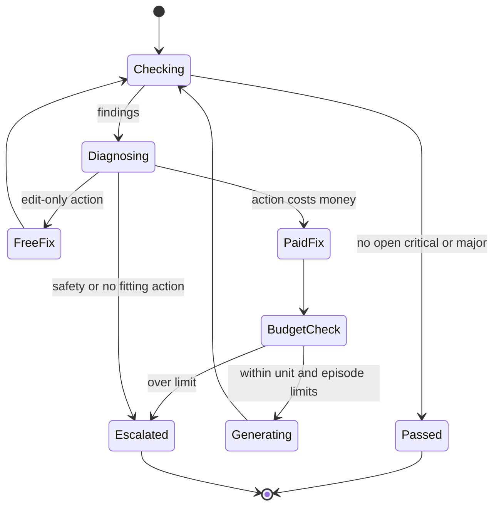

# Quality control framework

Status: planning draft, 26 November 2026.

Quality control (QC) decides, without a person, whether a take, a scene and an episode are good enough to show the owner. When something fails, it says what is wrong, where, and what to do about it, and the self-correction loop acts on that.

## 1. Principles

1. **Measure first, judge second.** Anything a script can measure (duration, resolution, loudness, black frames, transcript match) is measured by code. Models judge only what code cannot: faces, performance, story.
2. **Every finding is located.** A finding names a take or segment and a time range, with evidence (frames, numbers). "The episode feels off" is not a finding.
3. **Every finding has a suggested action** from a fixed list (§6), so the correction engine can act without interpretation.
4. **Judges are narrow.** One model call checks one thing against one rubric with fixed questions. A single "rate this video 1 to 10" call is not used.
5. **Automation has a budget.** Each unit gets a maximum number of automatic retakes and a cost ceiling. Past that, the issue goes to a person.
6. **QC is calibrated.** Thresholds are set on real accepted and rejected Madhopur takes, and the false-pass and false-fail rates are tracked.

## 2. Where QC runs



Tier 1 runs on every file. Tier 2 runs on every take that passes Tier 1. Tier 3 runs on every assembled version.

## 3. Severity

| Severity | Meaning | Default handling |
|---|---|---|
| critical | Unusable or unsafe: safety failure, wrong person, corrupt file, missing dialogue | Never shown as a pass. Safety criticals always go to a person. |
| major | A viewer would notice: face drift, wardrobe change, lip-sync off by more than 3 frames, wrong line | Auto-fix within budget, else escalate |
| minor | Noticeable on close watch: small hand artefact, slight colour mismatch | Auto-fix only if cheap (edit-only); otherwise listed for the owner |
| info | Worth knowing: a take is 0.4 s shorter than planned | Logged |

An episode version goes to the owner only when it has no open critical findings and no open major findings, or when the correction budget for them is spent. In the second case the review screen shows them first.

## 4. Checks

### 4.1 Tier 1: technical probe (code only)

| Check | Pass rule |
|---|---|
| File integrity | Probes cleanly; video and audio streams present as expected |
| Resolution and aspect | Matches the requested size and 9:16 (or series aspect) |
| Duration | Within ±0.5 s of request |
| Frame rate | Matches series fps or is convertible |
| Black or frozen frames | No run longer than 0.25 s unless planned |
| Flash / luminance spikes | Below the photosensitive-safety limits (no more than three flashes per second) |
| Audio levels | No clipping; native audio present if requested |

### 4.2 Tier 2: visual checks per take

| Check | Method | Fails as |
|---|---|---|
| Face identity | Face embedding vs look references, frames sampled each 0.5 s | major if below threshold on more than 20% of frames with a face |
| Extra or missing people | Person count vs shot plan | major |
| Wardrobe | Vision judge with fixed yes/no questions from wardrobe facts | major |
| Location features | Vision judge vs location view fixed features | minor or major |
| Anatomy and artefacts | Vision judge on sampled frames: hands, eyes, limbs, melting objects, text garbage | minor or major by size and duration |
| Camera and action | Vision judge: did the planned action and camera move happen, in order | major if the beat is missing |
| Faces cut by frame | Face boxes inside the 9:16 safe area; nothing important under subtitle or UI zones | major for a main character |
| Lips | Mouth moving when no line is planned | minor (fixable by cutting away) |
| Safety | Safety judge for protected characters and series content policy | critical |

### 4.3 Tier 2: audio checks per line

| Check | Method | Fails as |
|---|---|---|
| Words | ASR transcript vs script line, normalised; word error rate threshold | major |
| Names | Each name in the line found in the transcript | major |
| Voice identity | Speaker embedding vs locked voice | major |
| Delivery | Duration within the slot; no long silences inside the line | minor |
| Lip-sync | Audio–visual offset estimate on the spoken segment; over 3 frames fails | major |

### 4.4 Tier 3: episode checks

| Check | Method |
|---|---|
| Cut continuity | For each cut, frames either side compared: screen direction, wardrobe, props, light, positions |
| Story beats present | Shot descriptions plus transcript checked against the script beats in order |
| Dialogue completeness | Every script line present once, at the planned place, with subtitles |
| Subtitle sync and style | Subtitle in and out within 100 ms of the spoken words; inside safe area; correct style |
| Audio mix | Integrated loudness -14 LUFS ±1; true peak ≤ -1.5 dBTP; music ducked under dialogue |
| Pacing | Total duration within target ±5%; no shot held longer than its planned hold +1 s unless marked |
| Opening and ending | Hook visible within the first 3 s; ending holds for the planned beat; cut to black if planned |
| Cards and text | Name cards spelled right, inside safe area, on screen long enough to read |
| Continuity with Bible | Continuity agent checks the cut against the continuity packet |

### 4.5 Script and plan checks (before any money is spent)

QC starts before generation. The script and plan are checked for: missing references, protected-person rule breaks, story contradictions, units longer than the model supports, more references than the model takes, impossible actions for the model (for example, fine hand work, readable text in the frame), and estimated cost over budget. These are the same kind of gates as the short-drama preset's `check.py`, kept as code.

### 4.6 Safety

The safety check runs on every take with a protected character and on every final episode. It looks for any breach of CHARACTER_VOICE_CONTINUITY_SYSTEM §7 and the series content policy. Its findings are critical, are never auto-waived, and block the take from use.

## 5. The multi-agent evaluation panel

For judgments a script cannot make, the studio uses a panel of narrow judges rather than one reviewer. Each judge gets one rubric, the minimum evidence it needs, and must answer fixed questions in a structured format.

| Judge | Evidence it sees | Questions |
|---|---|---|
| Identity judge | Reference set + sampled frames | Is this the same person? Which frames differ? What differs (face shape, age, skin, hair)? |
| Wardrobe and props judge | Facts valid now + frames | Is each listed item present and correct? |
| Action judge | Shot plan + frames + timestamps | Did each planned action happen, in order? |
| Artefact judge | Frames | Any malformed hands, faces, objects or text? Where? |
| Performance judge | Clip + line + delivery notes | Does the emotion match? Is the line readable on the face? |
| Continuity judge | Frames either side of each cut + facts | Any jump in position, direction, light, costume? |
| Story judge | Script beats + transcript + shot descriptions | Is every beat present and understandable? |
| Safety judge | Frames + policy | Any policy breach? |

How the panel decides:

1. Code checks run first. A take that fails code checks is not sent to judges.
2. Each judge returns pass, fail or unsure, with located evidence.
3. "Unsure" from any judge sends the item to a second, independent call with a different prompt framing. If they still disagree, the item is escalated as a minor finding.
4. Judges never see each other's answers before answering.
5. Judge prompts are versioned. A change to a judge prompt is tested against the calibration set before use.

Vision judging uses a model that accepts images; video is passed as sampled frames with timestamps. Which model does which judge is set in configuration so it can change as models change (see AI_AGENT_ARCHITECTURE).

## 6. From finding to action

Each finding carries a diagnosis and one suggested action from this list. The action list is the contract between QC and the correction engine.

| Action | When | Cost |
|---|---|---|
| `trim` | Artefact or extra mouth movement near the start or end of a take | Free |
| `cut_away` | Problem in the middle of a take that another angle can cover | Free if coverage exists |
| `reframe` | Face cut by frame, or artefact at the edge | Free (crop from a higher resolution take) |
| `grade_match` | Colour or light mismatch across a cut | Free |
| `audio_fix` | Level, timing, ducking, subtitle timing | Free |
| `replace_line` | Wrong words, wrong voice, mispronounced name | Low (one TTS line, maybe voice conversion) |
| `relipsync` | Lip-sync offset or new line on an existing take | Medium |
| `inpaint_region` | Local artefact (hand, object) with a video-edit model | Medium; only where a provider supports it |
| `retake_same` | Random failure; same prompt, new seed | Full unit cost |
| `retake_repaired` | Systematic failure; prompt with `[REPAIR]` block and adjusted references | Full unit cost |
| `split_unit` | Unit too long or too complex for the model | Full cost of the new units |
| `change_method` | For example, move from text-to-video to first-frame image-to-video | Full unit cost plus a keyframe image |
| `escalate` | Budget spent, safety issue, or no action fits | None |

The correction engine always tries the cheapest action that the diagnosis says can fix the issue. VIDEO_EDITING_AND_REVISION_ENGINE describes how actions run.

### 6.1 The repair block

A retake with `retake_repaired` adds a `[REPAIR]` section to the prompt, written from the finding:

```
[REPAIR] Previous take failed: Suman's face drifted older in 0:02–0:05
(identity score 0.61, threshold 0.74). Keep her face exactly as the
reference sheet: round face, small nose stud, centre-parted hair.
Do not add wrinkles. Keep the camera locked; no push-in.
```

## 7. Self-correction loop and limits



Default limits, configurable per series:

| Limit | Default |
|---|---|
| Automatic retakes per generation unit | 2 |
| Automatic correction spend per episode | 30% of the episode's estimated generation cost |
| Same failure twice with the same action | Switch to the next action in the list, or escalate |
| Identical request already failed | Never resubmitted (idempotency guard) |

Draft-first generation: where a provider offers a cheaper low-resolution mode, the first take of a risky unit runs at draft quality. Only a draft that passes Tier 2 is re-run at final quality with the same seed and settings, where the provider keeps results consistent across resolutions. The PoC measures whether this saves money for each model.

## 8. Calibration and metrics

Before the studio is trusted, QC is calibrated on a labelled set:

1. Collect Madhopur takes that a person kept and rejected, with the reason.
2. Run every check on them.
3. Set each threshold to meet the target rates below, and record the result.

| Metric | Target for the PoC |
|---|---|
| False pass on critical issues | 0 in the calibration set |
| False pass on major issues | ≤ 10% |
| False fail (good take rejected) | ≤ 20% |
| Owner agreement with QC pass on the final episode | ≥ 80% of findings the owner raises were already flagged or are taste notes, not defects |

QC metrics tracked in production: findings per episode by check, auto-fix success rate by action, retakes per kept second, escalations per episode, and the owner comments QC did not catch. That last list is reviewed after every episode and turns into new checks or better judge questions.

## 9. Reused pieces

| Existing | Reuse |
|---|---|
| `verify_final.sh` and qc-checklist from the video skills | Tier 1 and Tier 3 technical checks |
| `edl_check.py` from the short-drama editor | Timeline validation |
| `check.py` gates (plan, pictures, clips, film, edit) | Pre-generation gates |
| faster-whisper transcription used for the English dub | ASR for line checks |
| Higgsfield `video_analysis_create` (scene-by-scene analysis) | Optional second opinion for the story and action judges; measured in the PoC |
