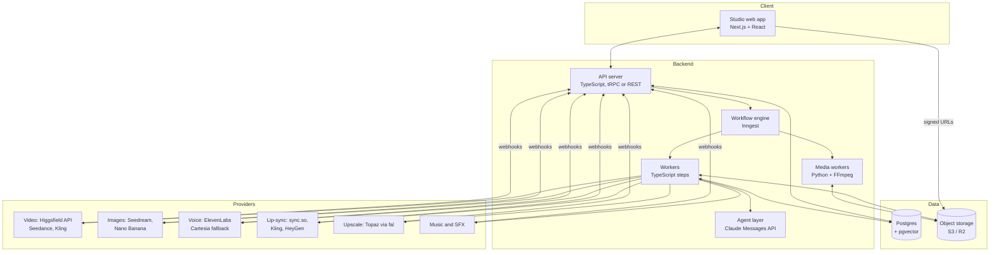
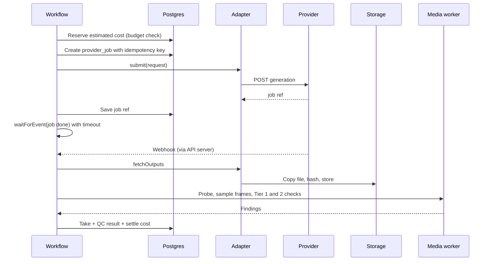
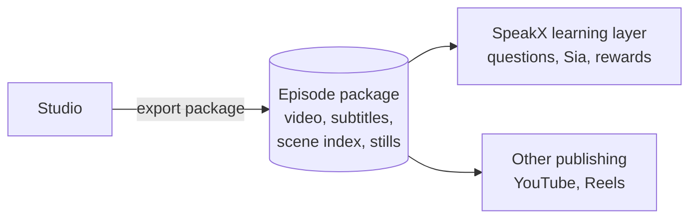

# System architecture

Status: planning draft, 26 November 2026. Facts about providers come from the verification notes in `research/`.

## 1. Shape of the system

The studio is a normal web application with a durable workflow engine behind it. Claude is used as the reasoning layer inside specific steps. Generation providers are called through adapters. Files live in object storage. Postgres holds every fact.



## 2. The three architectural principles, applied

| Principle from the brief | How the architecture honours it |
|---|---|
| Claude is the brain, not the whole system | Claude is called inside workflow steps with structured inputs and outputs. The workflow engine, not a model, decides order, retries, budgets and gates. Media work is code. |
| Never feed only the previous MP4 to make the next episode | Each episode starts from the continuity packet built from Postgres: facts, end states, key frames, approved looks and voices. The MP4 is an output, not an input. |
| An intelligent correction engine, not a regenerate button | Review comments and QC findings resolve to targets through the timeline index and the dependency graph, then to the cheapest action (VIDEO_EDITING_AND_REVISION_ENGINE). |

## 3. Components

| Component | Responsibility | Technology |
|---|---|---|
| Studio web app | Dashboard, setup wizard, Bible editor, review screen, cost views | Next.js (React, TypeScript), Tailwind, wavesurfer.js, a timeline component |
| API server | Auth, CRUD, starting workflows, receiving provider webhooks, signed upload and download URLs | TypeScript (Next.js route handlers or a separate Fastify service) |
| Workflow engine | Durable workflows, waits for people and webhooks, retries, per-provider concurrency | Inngest (see §5) |
| Workers | Workflow steps: prompt assembly, provider calls, QC orchestration, bookkeeping | TypeScript |
| Media workers | Probing, frame sampling, face and voice embeddings, FFmpeg rendering, subtitles, loudness | Python (the existing scripts), FFmpeg, faster-whisper, a face-embedding model |
| Agent layer | Script parsing and drafting, planning, continuity checks, judges, edit decisions, revision intent | Claude via the Messages API with tool use and structured outputs |
| Postgres | All records (DATABASE_AND_DATA_MODELS) | Managed Postgres (Neon, Supabase or RDS) with pgvector |
| Object storage | All files, content-addressed | S3 or Cloudflare R2 (R2 has no egress fees, useful for video review) |
| Provider adapters | One module per provider with a common interface | TypeScript |

## 4. Provider adapter interface

Every provider is wrapped behind the same small interface, so models can be swapped per series or per unit without touching workflows.

```ts
interface GenerationAdapter {
  id: string;                         // "higgsfield.seedance-2.0"
  capabilities(): Capabilities;       // durations, resolutions, max refs, audio, methods
  estimate(req: GenRequest): Cost;    // from a price table, versioned
  submit(req: GenRequest, idem: string): Promise<ProviderRef>;
  status(ref: ProviderRef): Promise<JobStatus>;
  parseWebhook(body: unknown, sig: string): JobStatus | null;
  fetchOutputs(ref: ProviderRef): Promise<RemoteFile[]>;
}
```

Capabilities drive the planner: a unit is never planned longer than the chosen model's maximum, or with more references than it accepts. Price tables are data, versioned, and refreshed by a person when a provider changes prices.

## 5. Workflow engine choice

Requirements: wait for a person for days, wait for provider webhooks, fan out 10 to 60 jobs, limit concurrency per provider, retry safely, TypeScript, low cost at small scale, little to operate.

| Option | Fit |
|---|---|
| **Inngest (recommended)** | Built-in concurrency keys, throttling and rate limits per provider; `waitForEvent` for owner approvals and webhooks; TypeScript; hosted with a free tier and $99 Pro. Runs are capped at 90 days, so each review round is its own run rather than one run per episode. |
| Temporal | Strongest durability and unlimited waits. More concepts and more to operate; Cloud at $50 per million actions. The right move if the studio grows to many series and engineers. |
| Trigger.dev v4 | Good TypeScript fit and long waits; no first-party rate limiter, which this system needs per provider. |
| Restate | Capable, smaller ecosystem, paid prices unpublished. |
| n8n | Visual automation; weak at fan-out, typed state and per-provider limits. Not suitable as the core. |

The workflow code is kept behind a thin internal interface (`step`, `waitFor`, `fanOut`) so a later move to Temporal is a contained change.

## 6. Data flow for one generation unit



If no webhook arrives before the timeout, the workflow polls the provider status. Either path is safe because the job reference is saved before waiting.

## 7. Security and access

- Provider keys live in the platform's secret store, never in the browser or the repository. Each key is scoped and spend-capped where the provider allows (ElevenLabs keys can be credit-capped and IP-allowlisted).
- Webhooks are verified by signature (Higgsfield, Kling and fal sign theirs).
- Assets are served through short-lived signed URLs. Each series is isolated by `series_id` in every query (row-level security in Postgres).
- Users and roles: owner, editor, reviewer, viewer. Only owners approve Bible changes and budgets.
- The studio needs its own credentials for every service. Connectors signed in through claude.ai cannot be reused by a backend (research notes, section "Running Claude headlessly").
- Voice cloning is allowed only with a stored consent record (CHARACTER_VOICE_CONTINUITY_SYSTEM §6.1).
- Audit trail in `event_log` for approvals, Bible edits, budget changes and spend.

## 8. The SpeakX learning layer stays separate

The studio produces episodes. The SpeakX learning layer (questions, Sia, rewards, as in the prototype) consumes them. The boundary is an export package: clean master, subtitled master, subtitles, a scene index with timestamps and dialogue, key stills, and clip ranges suitable for questions. The learning layer has its own repository, data and release cycle. Nothing in the studio depends on it, and the studio can produce series that have no learning layer at all.



## 9. Deployment

| Piece | Where |
|---|---|
| Web app and API | Vercel or a container platform (Fly.io, Render, Railway) |
| Workers | Same platform; Inngest calls them over HTTPS |
| Media workers | Containers with FFmpeg and Python, 2 to 4 vCPU, scaled to zero when idle; a GPU is not needed for FFmpeg; face embeddings run on CPU at this scale |
| Postgres | Managed, with point-in-time recovery |
| Storage | R2 or S3 with versioning |
| Observability | Structured logs, error tracking (Sentry), workflow dashboard (Inngest), cost dashboard (own) |

Environments: local (Docker Compose with the Inngest dev server), staging (own keys with low spend caps), production.

## 10. Scale assumptions

The design targets one team making 1 to 5 series at once, up to 10 episodes a week. At that scale a single Postgres, one media worker pool and hosted Inngest are enough. Provider concurrency, not the studio, is the bottleneck: Higgsfield allows 20 concurrent requests per key, ElevenLabs 5 to 15 by plan, fal starts at 2.
