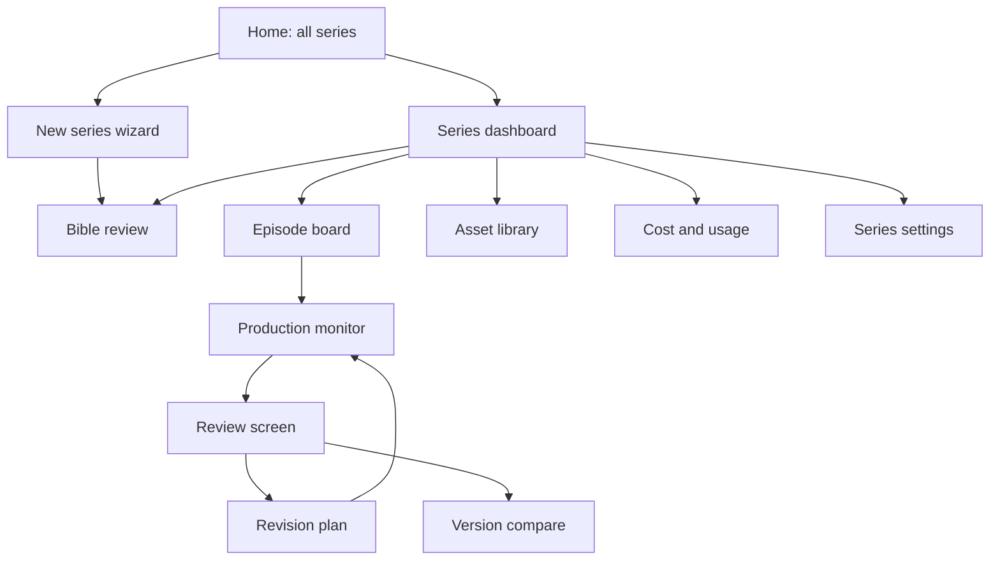

# UI and UX specification

Status: planning draft, 26 November 2026. Desktop-first web app; review also works on a tablet. Phone is used to preview episodes as viewers see them.

## 1. Users

| User | Main jobs |
|---|---|
| Owner (showrunner, for example Nishtha) | Create series, approve the Bible, approve budgets, review and approve episodes |
| Editor | Review, comment, request revisions, compare versions |
| Reviewer | Watch and comment only |
| Viewer | Watch approved episodes |

## 2. Screen map



## 3. Screens

### 3.1 Home
Cards for each series: thumbnail, name, status, episodes approved of planned, spend this month against budget, and anything waiting on the user ("2 approvals waiting").

### 3.2 New series wizard
Seven steps, each saved as a draft so the owner can leave and return:

1. **Basics:** name, logline, genre, language (with Hinglish option), audience, content rating.
2. **Format:** aspect ratio (9:16 default), target episode length, episode count, fps.
3. **Style:** visual style picker with example frames, colour mood, pacing, music feel; upload moodboard images.
4. **Documents:** drag-and-drop scripts, character notes, world notes, moodboards, voice samples (Markdown, PDF, DOCX, images, audio). Each file shows parse progress.
5. **Mode:** script-driven, AI-assisted or autonomous, with a plain description of where the studio will stop to ask.
6. **Budget:** per-episode and series caps; which paid steps need approval.
7. **Review:** summary, then "Build the Bible".

### 3.3 Bible review
Tabs: Characters, Voices, Locations, Props, Style, World and rules, Story so far.

- **Character page:** looks as columns (for example Veer at five, Veer at seventeen), each with its reference set in a grid, approve and regenerate buttons on each image, the description, wardrobe, personality, relationships, and the protection flag shown clearly with its source.
- **Voice page:** play previews, pick one, play sample lines, edit pronunciations, lock.
- **Questions panel:** every ambiguity from ingest, answered inline.
- **Changes:** for a new Bible version, a diff of what changed and why, with the episode that caused it.

### 3.4 Episode board
A row per episode with stage chips (Script, Plan, Board, Generate, Audio, Edit, QC, Review, Approved) and the current version. Opening an episode shows the script, plan and storyboard tabs.

### 3.5 Production monitor
Live view while an episode is made:

- Stage progress, with the unit grid: each unit a tile showing keyframe, then take thumbnails as they land, coloured by QC state (pending, pass, fixing, escalated).
- Cost so far against estimate, updated per job.
- A log in plain language ("Unit c4 failed the face check; retaking with a repair note. Retake 1 of 2.").
- Pause and cancel buttons. Cancel never deletes anything already made.

### 3.6 Review screen
The central screen of the studio.

```
┌──────────────────────────────────────────────────────────────────┐
│ Madhopur · Episode 1 · Version 3       [Compare ▾] [Approve]     │
├───────────────────────────┬──────────────────────────────────────┤
│                           │ QC report (2 escalated)              │
│     9:16 player           │  ▸ 0:41 Suman face drift (major)     │
│     (draw box on frame    │  ▸ 1:12 Hand artefact (minor)        │
│      to mark a region)    │──────────────────────────────────────│
│                           │ Comments                             │
│                           │  0:58 Hold her reaction longer       │
│                           │  1:20 Music too loud under "सुमन…"   │
│                           │  [+ Comment at 1:03]                 │
├───────────────────────────┴──────────────────────────────────────┤
│ Timeline strip: shot thumbnails · subtitles · waveform · markers │
└──────────────────────────────────────────────────────────────────┘
```

Behaviour:

- Pressing C pauses and opens a comment at the playhead; dragging on the timeline strip sets a range; dragging on the frame marks a region.
- Each comment has a category chip, suggested automatically from the text and editable.
- QC findings appear as markers on the strip, in a different colour from comments.
- A phone-frame toggle previews the video at phone size with the subtitle and UI safe areas shown.
- "Request changes" sends all open comments to the revision analyst and opens the revision plan.
- "Approve" asks once for confirmation and starts close-out.

### 3.7 Revision plan
A list of proposed actions, grouped by comment, each with what it changes, what it leaves alone, cost, and a checkbox. Totals at the bottom. Canon changes are shown separately and always need a tick. Buttons: approve selected, edit plan, cancel.

### 3.8 Version compare
Two players side by side, synced. Changed segments highlighted on a shared strip. Per-segment "use this one" to cherry-pick. Restore button.

### 3.9 Asset library
Every image, clip, audio file and document for the series, filterable by type, character, location, episode and status. Each asset shows where it is used, how it was made (provider, model, prompt) and what it cost.

### 3.10 Cost and usage
Spend by series, episode, stage, provider and reason (first take, auto-fix, revision, failed). Estimated against actual. Cost per approved second. Budget remaining.

## 4. Interaction rules

1. Nothing paid starts without either a standing approval in settings or a click with the cost shown.
2. Every long job shows progress and can be left; the user is notified (in app and by email) when it needs them.
3. Every destructive-looking action is reversible: rejecting a take, restoring a version and cancelling a run never delete files.
4. Plain language everywhere; model names and technical details are behind a "details" toggle.
5. Devanagari and Latin text render correctly in every field, subtitle preview and card preview.

## 5. Accessibility and performance

- Keyboard shortcuts for review (space, J/K/L, C, arrows for frame steps).
- WCAG 2.2 AA contrast; focus states; captions on all previews.
- Review proxies stream from storage with signed URLs; first frame within 2 s on a normal connection.
- Thumbnails and waveforms are pre-computed by media workers, not in the browser.
