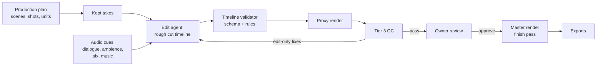
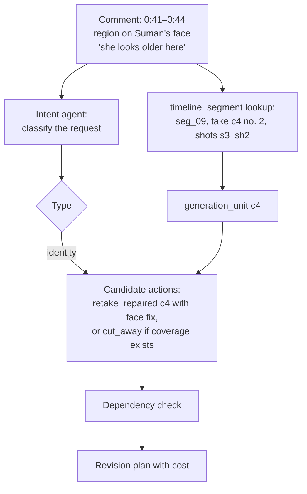
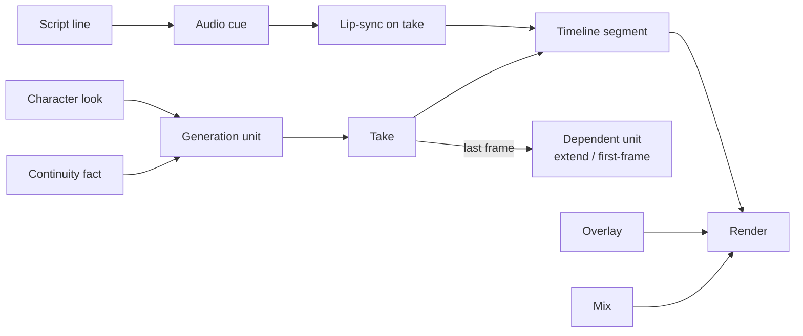

# Video editing and revision engine

Status: planning draft, 26 November 2026.

This document covers how an episode is assembled from takes and audio into a finished video, and how a review comment becomes the smallest change that fixes it. It is the "intelligent correction engine" required by the brief: the studio never regenerates a whole episode to fix one moment.

## 1. Design decisions

1. **The edit is data.** Every episode version has a timeline document (DATABASE_AND_DATA_MODELS §6). The rendered MP4 is a by-product. All editing operations change the timeline, never the MP4.
2. **Rendering is deterministic.** The same timeline and the same assets always produce the same file. This makes renders cacheable and versions comparable.
3. **One renderer, two speeds.** A fast proxy render (540×960, fast preset) for review and QC, and a master render (1080×1920 or above) after approval or on request.
4. **FFmpeg is the renderer for picture and sound; Remotion is optional for graphics.** FFmpeg handles cutting, scaling, grading with LUTs, audio mixing, loudness and subtitle burn-in, and the existing scripts already do this. Remotion (React-based video rendering) is used only if the series needs animated cards or graphics that are easier to write as web components. Remotion has a commercial licence for companies above its free-use threshold; that cost is listed in COST_OPTIMISATION_FRAMEWORK.
5. **Revisions change only what depends on the change.** A dependency graph says what must be redone.

## 2. Assembly pipeline

### 2.1 Rough cut

The edit agent places kept takes in shot order and sets in and out points from:

- the shot plan's target durations,
- the dialogue cue timings (word timestamps from ASR),
- the beats in the script (hold on a reaction, cut on an action),
- the series editing style (pace, preferred transitions).

It writes a timeline, not a video. The timeline validator then checks it: every shot covered, no gaps or overlaps on the picture track, every script line placed once, segments inside the take's real duration, overlays inside the safe area, and total duration within target. This is the existing `edl_check.py` logic made general.

### 2.2 Audio

Tracks are kept separate end to end: dialogue, ambience, effects, music, and (for the SpeakX layer, outside the episode) narration. The mix step:

1. Places dialogue cues at their timeline positions.
2. Lays ambience per scene, with crossfades at scene changes.
3. Places effects from the script's sound notes and the edit agent's choices.
4. Places music cues and ducks them under dialogue.
5. Normalises to -14 LUFS integrated with true peak at or below -1.5 dBTP.

Sources: native audio from the video model where kept, TTS lines, voice-converted lines, a licensed effects library, and generated music. Every source and licence is recorded on the audio cue.

### 2.3 Subtitles and cards

Subtitles come from the script line text, timed to the word timestamps of the delivered line, not from a fresh transcription. This keeps spelling correct (Devanagari, names). Style comes from the series style guide. Name cards and title cards are overlays in the timeline.

The prototype work found that burning subtitles into the master and keeping a clean master both matter: a clean master is needed for dubbed or re-subtitled versions. The renderer therefore always produces a clean master plus a subtitled master.

### 2.4 Finish pass

After approval, the master render applies: per-shot colour match to the series look, the series LUT, optional upscale for takes generated below master resolution, light film grain to hide generation texture differences, and final loudness. These steps exist today in `finish.py`, `shot_colour.py` and `reframe.py` in the end-to-end-video-creation skill and are reused as library functions.

## 3. Timestamp feedback to targets

A review comment has a time range, an optional screen region, a category and free text. The engine resolves it to targets:

Comment categories and what they usually change:

| Category | Example | Typical targets |
|---|---|---|
| Timing / pace | "Hold her reaction longer" | Timeline only |
| Order | "Show the ship before Devendra's face" | Timeline only |
| Dialogue words | "Change the line to 'डरो मत, बेटा'" | Script line → audio cue → maybe lip-sync |
| Delivery | "Say it softer" | Audio cue |
| Pronunciation | "Devendra is pronounced wrong" | Pronunciation dictionary → audio cue |
| Identity / look | "She looks older here" | Generation unit (retake) |
| Wardrobe / prop | "Wrong shirt" | Generation unit; maybe a continuity fact |
| Action / performance | "He should take her hand, not wave" | Generation unit |
| Camera | "Closer shot here" | Reframe if resolution allows, else retake |
| Artefact | "Hand looks wrong" | Trim, cut away, inpaint, or retake |
| Sound / music | "Music too loud" | Mix |
| Subtitles / cards | "Spelling of Madhopur" | Overlay |
| Story / canon | "Suman wouldn't say that, she doesn't know yet" | Script + continuity fact + whatever depends on it |

## 4. Revision actions

The action list is shared with QC (QUALITY_CONTROL_FRAMEWORK §6). The engine adds actions only a person would ask for:

| Action | Effect |
|---|---|
| `edit_timeline` | Trim, move, reorder, change transition, change hold |
| `edit_overlay` | Change subtitle text or timing, card text or style |
| `edit_mix` | Gain, ducking, music cue swap |
| `edit_line` | New script text for a line; triggers audio and maybe lip-sync |
| `edit_canon` | Proposes a Bible change; owner must approve; may trigger more actions |
| `add_shot` | New shot and generation unit (insert, cutaway) |
| `remove_shot` | Drops a shot; timeline closes the gap |
| plus all QC actions | `trim`, `cut_away`, `reframe`, `grade_match`, `audio_fix`, `replace_line`, `relipsync`, `inpaint_region`, `retake_same`, `retake_repaired`, `split_unit`, `change_method` |

## 5. Dependency graph and selective regeneration

What depends on what:

Rules:

1. Changing a node marks every node downstream as stale. Nothing upstream changes.
2. A dependent unit (one that started from another unit's last frame) is stale if its parent take changes. The engine then checks whether the new parent's last frame is close enough to the old one (frame similarity). If it is, the dependent unit is kept; if not, it is regenerated or its first frame is re-anchored.
3. A change to a look or continuity fact marks every unit that used it in this episode as stale. The plan shows the count and cost before anything runs, because this can be expensive.
4. Stale nodes that are free to rebuild (timeline, mix, overlays, render) are rebuilt automatically. Paid nodes go into the revision plan for approval if the series requires it.

## 6. The revision plan

Before anything paid runs, the owner sees a plan like this:

> **Episode 1 · Version 3 → Version 4**
> 1. Hold Suman's reaction 1.5 s longer (0:58). Edit only. Free.
> 2. Suman looks older at 0:41–0:44. Retake unit c4 with a face repair block. Unit c5 starts from c4's last frame and will be checked; it may also need a retake. Estimated $1.20 to $2.40.
> 3. Change Suman's line to "डरो मत, बेटा". New voice line and lip-sync on c5. Estimated $0.45.
> 4. Lower the music under "सुमन…" by 4 dB. Edit only. Free.
>
> Unchanged: 11 of 14 segments, all other audio. Estimated total $1.65 to $2.85. Approve all, approve some, or edit.

Approval rules come from the series settings: free actions can run without approval; paid actions under a per-revision threshold can be pre-approved; anything that changes canon always needs approval.

## 7. Running a revision

1. A new episode version is created, copying all pointers from the parent.
2. Actions run in dependency order. Independent paid actions run in parallel up to provider limits.
3. Each new take goes through Tier 1 and Tier 2 QC. The self-correction loop applies, within the revision's budget.
4. The timeline is rebuilt for affected segments; Tier 3 QC runs on the whole episode, because a local change can break a cut.
5. The new version goes to review with a change summary and a side-by-side compare of each changed segment.

## 8. Version comparison and restore

- **Compare** shows two versions side by side, synced, with changed segments highlighted on the timeline strip. A per-segment toggle plays the old and new take in place.
- **Restore** creates a new version whose pointers equal an older version's. No history is lost.
- **Cherry-pick** takes one segment's take from an older version into a new version (for example, "keep version 2's ship reveal").

## 9. Exports

| Export | Contents |
|---|---|
| Master, clean | 1080×1920 (or higher), no burned subtitles, final mix |
| Master, subtitled | Same with burned subtitles in the series style |
| Subtitle files | SRT and VTT per language |
| Stems | Dialogue, music, effects, ambience as WAV |
| Thumbnail candidates | Frames scored for faces and readability, plus generated thumbnail options |
| Project bundle | Timeline JSON, take list, asset manifest, for re-editing |
| SpeakX package | Clean master, subtitles, a scene index with timestamps and dialogue, for the learning layer (kept separate; see SYSTEM_ARCHITECTURE §8) |

## 10. Reused pieces

| Existing | Reuse |
|---|---|
| `assemble.py`, `render.py`, cut-list JSON | Basis of the timeline renderer |
| `burn_captions.py`, `subs.py`, `captions_from_timeline.py`, `transcribe_words.py` | Subtitle placement and timing |
| `finish.py`, `shot_colour.py`, `reframe.py` | Finish pass |
| `edl_check.py` | Timeline validator |
| `verify_final.sh` | Export verification |
| Review-and-versioning reference from the video skill | Version naming and change summaries |
| Eddie (heyeddie.ai) connector | Not used in the pipeline: no API for unattended use. Possible manual editing tool for a person |
| Higgsfield editing room tools | Possible manual tool; not in the automated path |
