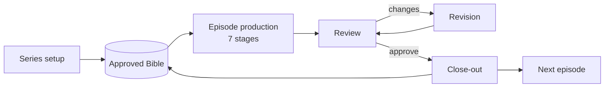
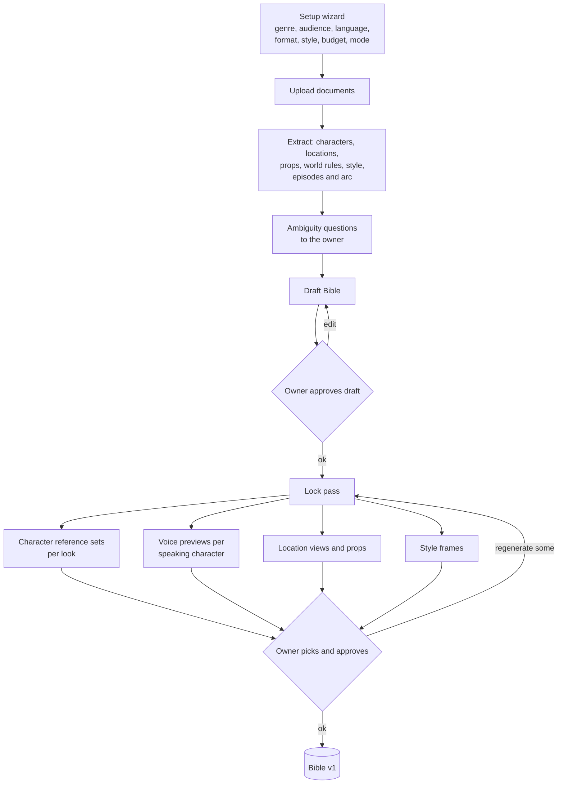
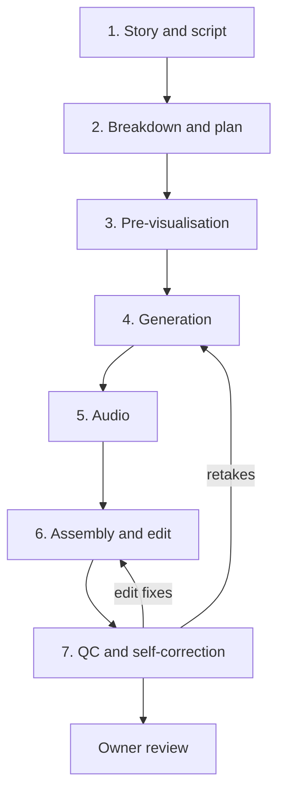
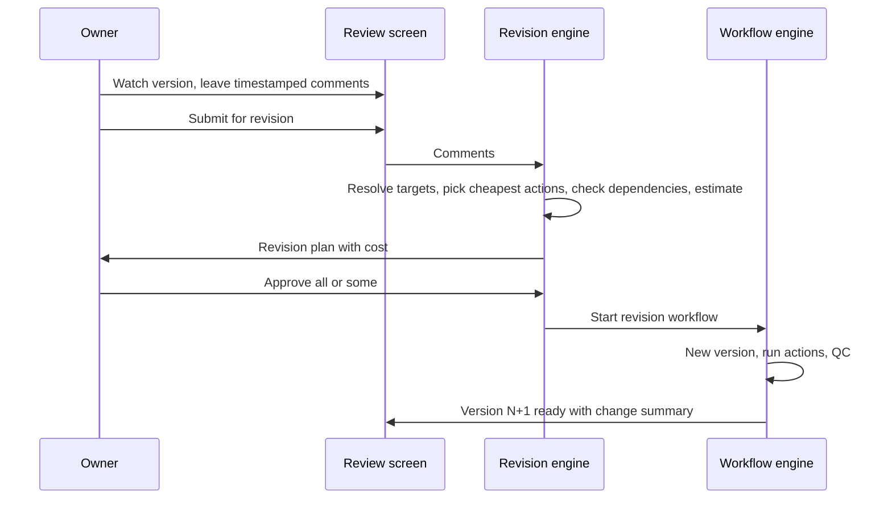

# Workflow design

Status: planning draft, 26 November 2026.

This document defines the workflows the studio runs: series setup, episode production in seven stages, review and revision, and episode close-out. It says what each stage takes in, what it produces, what checks it, where a person may be asked to approve, and what happens on failure. The durable workflow engine that runs these is chosen in SYSTEM_ARCHITECTURE §5.

## 1. Workflows at a glance

| Workflow | Starts when | Ends when | Typical length |
|---|---|---|---|
| Series setup | Owner creates a series | Bible version 1 approved | 1 to 3 days, mostly waiting on the owner |
| Episode production | Owner starts an episode, or the previous one closes in autonomous mode | Version in review | 1 to 4 hours of machine time |
| Revision | Owner submits review comments | New version in review | Minutes (edit-only) to an hour |
| Close-out | Owner approves a version | New Bible version cut | Minutes plus owner check |

Every workflow is durable: it survives a server restart, waits days for a person without holding resources, and resumes from the last finished step.

## 2. Production modes

| Mode | Who writes the story | Where the workflow pauses |
|---|---|---|
| **A. Script-driven** | The owner uploads the script | Script parse review (optional), plan approval (optional), final review |
| **B. AI-assisted** | AI drafts from the owner's outline; the owner edits | Outline approval, script approval, plan approval (optional), final review |
| **C. Autonomous** | AI writes from the Bible and the series arc | Final review only, unless a budget, safety or canon gate trips |

Madhopur is mode A: the five episode scripts already exist in the master production document.

Gates that pause any mode: estimated cost over budget, a safety finding, a proposed canon change, a new character or location without approved references, and escalated QC findings.

## 3. Series setup

Lock pass cost is low because it makes images and short audio only. For Madhopur most of it already exists and is imported (see MASTER_IMPLEMENTATION_PLAN, proof of concept).

## 4. Episode production: the seven stages

Stages 4 and 5 overlap in practice: dialogue lines for a unit are made before that unit if the series uses the TTS-first path.

### Stage 1. Story and script

| | |
|---|---|
| Input | Continuity packet (CHARACTER_VOICE_CONTINUITY_SYSTEM §5), series arc, owner script or outline |
| Work | Mode A: parse the script into scenes and lines with stable IDs. Mode B and C: draft, then parse. Continuity agent checks the script against the packet. Safety rules applied. |
| Output | Approved `script` with scenes, lines and beats |
| Checks | Every speaking character exists in the Bible; no contradictions; protected-person rules; target duration plausible (lines × speaking rate + action time) |
| Gate | Mode B: owner approves. Mode A and C: only on a flagged issue |

### Stage 2. Breakdown and production plan

| | |
|---|---|
| Input | Script, Bible |
| Work | Split scenes into shots (framing, angle, move, blocking, duration, line IDs). Group shots into generation units that fit the chosen model (length, reference count, one location, continuous action). Choose method per unit (reference, first-frame, first-last-frame, extend). Choose references per unit (§3.3 of the continuity document). Estimate cost per unit. |
| Output | `plan` with scenes, shots, generation units, references, prompts, estimate |
| Checks | Pre-generation gates (QUALITY_CONTROL_FRAMEWORK §4.5): units within model limits; references exist and are approved; total estimate within budget; dependency order valid |
| Gate | Optional plan approval with cost; always if over budget |

### Stage 3. Pre-visualisation

| | |
|---|---|
| Input | Plan |
| Work | For each unit, generate a keyframe image with the same references (cheap: a few cents). Build a storyboard strip and an optional animatic with temp audio. For first-frame units the keyframe becomes the actual first frame. |
| Output | Keyframes, storyboard, animatic |
| Checks | Identity, wardrobe and location checks on keyframes (same as Tier 2, on stills). A failing keyframe is regenerated before any video money is spent. |
| Gate | Optional storyboard approval |

This stage is the main cost saver: a wrong face or set is caught on a $0.05 image instead of a $1 to $5 clip. The board-before-video stage of the end-to-end-video-creation skill already works this way.

### Stage 4. Generation

| | |
|---|---|
| Input | Plan, keyframes, references, dialogue audio where TTS-first |
| Work | Submit units in dependency order; independent units in parallel up to provider concurrency. Draft quality first for risky units where the provider supports it. Poll or receive webhooks. Download, hash, probe and store each take. |
| Output | Takes per unit |
| Checks | Tier 1 and Tier 2 QC on each take as it lands |
| Failure | Provider error: retry with backoff on a transient error, never on a content block. Content block: escalate. QC failure: self-correction loop within budget. |

### Stage 5. Audio

| | |
|---|---|
| Input | Script lines, voices, kept takes, sound notes |
| Work | Dialogue: TTS in the locked voice, or voice conversion of native audio. Lip-sync where the path needs it. Ambience and effects from the library or generated. Music cues generated or chosen from a licensed set. Word timestamps by ASR. |
| Output | Audio cues |
| Checks | Tier 2 audio checks per line (words, names, voice identity, lip-sync) |

### Stage 6. Assembly and edit

| | |
|---|---|
| Input | Kept takes, audio cues, plan, style guide |
| Work | Edit agent builds the timeline; validator checks it; proxy render |
| Output | Timeline, proxy video |
| Checks | Timeline validator |

### Stage 7. QC and self-correction

| | |
|---|---|
| Input | Proxy render, timeline, everything upstream |
| Work | Tier 3 checks; findings to actions; free fixes applied; paid fixes within budget |
| Output | Version ready for review, with a QC report and any escalated findings |
| Limits | QUALITY_CONTROL_FRAMEWORK §7 |

## 5. Review and revision

Details are in VIDEO_EDITING_AND_REVISION_ENGINE §3 to §7.

## 6. Close-out

On approval: master render and exports, key-frame extraction, episode summary, end states, new and closed continuity facts, cost report, and a new Bible version after the owner accepts any canon changes. CHARACTER_VOICE_CONTINUITY_SYSTEM §9 has the sequence.

## 7. Failure handling

| Failure | Response |
|---|---|
| Provider timeout or 5xx | Retry with exponential backoff up to 3 times; then try the fallback provider for that model if configured; then escalate |
| Provider 429 / queue full | Wait and retry; lower this run's concurrency |
| Content or moderation block | No automatic retry with changed wording. Log, escalate with the prompt and the provider's reason |
| QC failure | Self-correction loop within limits |
| Cost cap reached | Pause the workflow; notify the owner with what is left and its estimate |
| Studio worker crash | Workflow engine resumes the step; idempotency keys stop double charges |
| Provider deletes output early | Every output is copied to our storage at once on completion (Replicate deletes after 1 hour; Higgsfield keeps 7 days) |
| Owner absent | Workflow waits indefinitely at a gate; reminders after 24 hours |

## 8. Idempotency and cost safety

- Each paid request has an idempotency key from provider, model and the normalised request. A repeat returns the stored job.
- The budget ledger is checked and the estimated cost reserved in one transaction before each submission. The reservation is released or settled when the job finishes.
- A workflow step that submits a job records the provider reference before waiting. On resume it waits on that reference instead of resubmitting.

## 9. Timing estimate for a 95-second episode

| Stage | Machine time | Notes |
|---|---|---|
| Script parse and checks | 2–5 min | Model calls |
| Plan | 5–10 min | Model calls |
| Keyframes | 5–10 min | 15 images in parallel |
| Generation | 20–60 min | 10–15 units, provider queue time dominates |
| Audio | 5–15 min | Lines in parallel; lip-sync adds time |
| Assembly and proxy | 3–8 min | FFmpeg |
| QC and fixes | 10–40 min | Depends on retakes |
| **Total** | **about 1 to 2.5 hours** | Owner time not included |

These are estimates. The PoC measures the real numbers.
